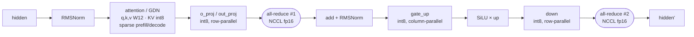

# Qwen3.8-27B on 2× V100: performance and accuracy report

This report covers one model, Qwen3.8-27B-ABLITERATED (hybrid: 48 Gated DeltaNet layers + 16 full-attention
layers, MTP head), served by one runtime on two Volta GPUs. It records what was measured, how, and where the
evidence lives. Numbers without a log or a reproducible procedure are not in this document.

Status legend used below: **measured** (log or probe output exists, procedure in this repo), **measured,
internal** (measured, raw data not published in this repo), **not measured** (no result yet).

Code: branch `sm70`, commit `8a59d8fb8`, lever set `configs/qwen38-27b-int8-clef.env`. The production
server runs this code; the only differences are machine-specific default paths (`FA2SM70_TM_ROOT`,
`FA2SM70_PATH`, `FA2SM70_CLEF_DIR`, the MTP hidden-state dump directory), checked file by file on 2026-10-24.

## 1. Quantization: what is stored at which precision, and why

### 1.1 Composition (measured from the checkpoint headers)

| Part | Parameters | Stored as | Served as |
|---|---|---|---|
| 346 linear modules of layers 1–63: MLP `gate/up/down` (189), GDN `in_proj_qkv/in_proj_z/out_proj` (141), attention `o_proj` (16) | 22.77 B | GPTQ int8, group 128, asymmetric | int8: tensor-core GEMV for decode, TurboMind s884 int8 GEMM / cuBLAS-reconstruct for prefill |
| Attention `q/k/v` (16 layers) | 1.18 B | BF16 | 12-bit (W12), repacked at load (`FA2SM70_W12=1`) |
| `lm_head` | 1.27 B | BF16 | int8 (`FA2SM70_LMH=1`) |
| MTP head (1 layer) | | BF16 | int8 (`FA2SM70_MTP_W8=1`) |
| Embeddings | 1.27 B | BF16 | fp16 |
| Layer 0, GDN `in_proj_ba`, vision tower | rest | BF16 | fp16 |

Effective size of the quantized modules: **8.188 bits per weight** including scales and zero points
(`qweight + qzeros + scales`, `g_idx` excluded). Whole checkpoint: 9.60 bits per parameter over 27.78 B
parameters. The computation runs in fp16; V100 has no BF16. The BF16 checkpoint overflows fp16 in the
residual stream (up to 4.9e5 against the fp16 limit of 65,504). The runtime therefore rescales
`o_proj`/`down_proj`/embeddings by `S` and the RMSNorm epsilon by `S²`; the identity gate is relL2 = 0.

### 1.2 Why mixed precision

Precision was chosen per tensor class by accuracy gates, not by the smallest model that fits:

* int8 is used wherever it passed the gates: long-context needles, Clef parity against the original Clef in
  fp16, and agreement with dense attention.
* Attention `q/k/v` in int8 did not pass and is served at 12 bits (**measured, internal**: engineering notes
  of 2026-08; the gate run is not reproduced in this repository).
* The modules excluded from quantization are the checkpoint's `quantization_config.dynamic` list: layer 0,
  `qkv_proj`, `in_proj_ba`, vision, MTP, `lm_head`.

The tensor error of the int8 conversion of this checkpoint is relL2 6.06e-3 (**measured, internal**).
The per-tensor check uses dequantized weights against BF16.

### 1.3 How far the int8 codes can be compressed losslessly (**measured, internal**)

This was a CPU study of the 346 int8 tensors (2026-10-17). It measured how many bits per weight the stored
codes actually carry. It does not estimate a theoretical entropy of the model.

| Method | Bits per int8 code |
|---|---|
| Stored | 8.00 (GPTQ stretches every group of 128 over all 256 levels) |
| Zero-order empirical entropy, per tensor | 7.578 (`L63.o_proj`) to 7.657 (`L5.gate_proj`) |
| Best general-purpose compressor on the worst tensor (zstd -19 / xz -9e / bzip2) | 7.68 / 7.75 / 7.91 |
| Learned predictor on the worst tensor (context: group zero/scale, the `up[i,n] ~ down[n,i]` coupling) | **7.519** |

Controls: each tensor shuffled within its groups of 128 gives the same entropy, so no structure across
positions was found. Mutual information with the same tensor of a neighbouring layer is 0.003–0.010 bits
per weight.

**Conclusion.** Lossless re-encoding can save at most ~6 % of the int8 bytes, and only with
variable-length codes in the GEMV inner loop. That is not worth a decode kernel on Volta, so the codes are
served as stored.

## 2. One resident checkpoint, two workloads

Chat and generation (`/v1/chat/completions`, `/v1/completions`) and Clef decisions (`POST /v1/systemone`)
are served by **the same resident weights, in the same batches**. Clef is not a second model, and there
is no second copy of the weights.

* A Clef record runs as a one-token prefill (`max_tokens=1`).
* For its rows only, the int8 GEMM kernels add two corrections to the output: `deabl` (rank 1, layers 2–63)
  and Clef's rank-256 LoRA (layers 40–63, streamed from pinned host memory).
* The final hidden states go into Clef's joint schema head, implemented in native CUDA.
* Chat rows in the same batch are untouched. With Clef on, the first token is bitwise identical to Clef off;
  decode shifts at ~1e-3, which a plain dummy allocation of the same size reproduces exactly (VALIDATION.md).
* Cost: +514 MiB on rank 0 (the head with 4 slots of 34,816 tokens) and +121 MiB on rank 1. There is no
  second weight set.
* Clef requests use their own `cache_salt` and never read the prefix cache.

## 3. Production validation on V100 (**measured**)

Wall-clock production traffic: two servers, real clients, nothing synthetic. Both were started after a
host reboot on 2026-10-23. The counters are vLLM's own `/metrics`, read on 2026-10-24 at 23:42:29 (+04).
The traffic was routed to the two pairs by the operator. It was **not** split evenly or by capacity, so the
averages below measure delivered load, not the maximum throughput of either pair.

| | NVLink TP2 (production, GPU2-3) | PCIe TP2 (test pair, GPU0-1) | Total |
|---|---|---|---|
| Server up | 2026-10-23 07:38:13, 40.07 h | 2026-10-23 07:52:45, 39.83 h | |
| Input tokens | 166,023,160 | 106,370,942 | **272,394,102** |
| Output tokens | 5,307,565 | 2,557,227 | **7,864,792** |
| of which chat output | 5,200,956 | 2,512,872 | 7,713,828 |
| Clef requests (`max_tokens=1`) | 106,609 | 44,355 | **150,964** |
| Chat requests | 2,272 | 4,026 | **6,298** |
| Average input rate, wall clock | 1150.9 tok/s | 741.9 tok/s | |
| Average output rate, wall clock | 36.79 tok/s | 17.83 tok/s | |
| Failed / aborted requests | 0 / 0 | 0 / 0 | |
| Preemptions | 0 | 0 | |
| MTP mean acceptance length (k = 3) | 3.83 | 3.58 | |
| MTP acceptance by position 1/2/3 | 0.975 / 0.944 / 0.909 | 0.926 / 0.854 / 0.795 | |
| Prefix-cache hits / queries | 0.14 % | 42.3 % | |

Notes on reading this table:

* **What the counts include.** Each Clef record produces exactly one engine token, which counts toward
  output; the API reports 0 output tokens for it. The input counts include Clef. vLLM's counters do not split
  prompt tokens by endpoint, so the chat share of input tokens is unknown.
* **Acceptance depends on the traffic.** It is far higher than on the probes (2.3–3.3 on natural text,
  VALIDATION.md), which says the production chat output is highly predictable from its context. The n-gram
  assist proposes in that case. It is not a property of the drafter alone.
* **Prefix-cache hit rate differs by two orders of magnitude** between the pairs under the same code and
  levers. It follows the traffic mix sent to each pair; the cause is not analysed.
* Configuration differences between the pairs:
  * the test pair runs with `NCCL_P2P_DISABLE=1`, because NCCL P2P setup over PCIe hangs at start
    (VALIDATION.md, Known effects);
  * the test pair loads vLLM from a copy of the package, so the production virtualenv is never touched by
    tests.
  
  Everything else is identical: the lever set of `configs/qwen38-27b-int8-clef.env`, int8 KV cache, 262,144
  tokens of KV capacity, fp16 all-reduce (`FA2SM70_EXCH12=0`).
* An earlier window on the same servers (2026-10-23 07:38 → 2026-10-24 15:35, ~32 h) gave 218,468,935 input
  and 5,659,805 output tokens, 135,222 Clef and 3,285 chat requests, 1151 / 754 input and 32.4 / 17.0 output
  tok/s. The table above supersedes it.
* The raw counters are in `docs/sm70/results/production_2026-10-24.json`; the BENCHMARKING.md schema
  applies.

### 3.1 Capacity numbers of the same stack (single-request probes, **measured**)

| | NVLink pair | PCIe pair |
|---|---|---|
| 250K-token prefill | 186.8 s (2026-09-15), median 215 s (2026-09-23), card temperature dependent | — |
| Prefill, cold cache, 1K–64K | — | 811–834 tok/s, flat in length (P2P off, 2026-10-18) |
| 243,173-token needle prompt | 228.4 s alone at 1293–1342 MHz, 78–82 °C (2026-10-13) | 238.5 s (2026-10-18) |
| Decode, single stream, MTP k = 3 | 55.8 / 58.4 / 48.6 tok/s at 32K / 128K / 250K on filler, 63.8 on natural text | 51.4 / 51.0 / 57.1 / 61.9 tok/s at 1K / 8K / 32K / 64K, acceptance 2.72 / 2.69 / 3.03 / 3.32 (P2P off) |

Clocks are not locked: application clock 1290 MHz, boost up to 1530 MHz. Locking at 1530 on a card with hot
HBM made it worse (memory at 87–89 °C, throttling to 472 MHz), so read `clocks.sm` and temperature next to
every timing.

## 4. A100 (SM80)

**Not measured in this repository.** Two facts constrain a port:

* The kernels in `sm70/` are built on `mma.sync m8n8k4` (HMMA.884). On `sm_80` they compile and give the
  same results, but run about 6× slower than on V100.
* A port means new atoms (`m16n8k16` for fp16/bf16, `m16n8k32` for int8) and `cp.async` / `ldmatrix`
  loads.

A100 results enter this document only as BENCHMARKING.md records with clocks, topology and the commit of
the A100 code.

| Benchmark (2× A100, contract per BENCHMARKING.md) | Result | Record |
|---|---|---|
| Prefill 8K / 32K / 131K, stable and best | not measured | — |
| Clef throughput | not measured | — |
| Decode C1 at 8K, C8 aggregate | not measured | — |

## 5. Correctness (**measured**)

All gates use `sm70/integrations/vllm_sm70/clef/proverka_stenda.py` and the probes in `sm70/tests/server/`
unless noted.

| Gate | Result | Where / when |
|---|---|---|
| Clef vs Cloudflare/clef in fp16, 10 records (152–16,384 tokens), 35 decisions | 35/35, max \|Δp\| 0.0093 | test pair, 2026-10-12; repeated by a fresh clone |
| Same, production NVLink pair | 34/35. The flip is record 9, a near-tie of six options (0.200/0.199; the reference scores it 0.1916/0.1913) | 2026-10-12, 2026-10-13 |
| Production after the 2026-10-19 deployment vs the test pair | 34/35, max \|Δp\| 0.0227, the same record 9 tie (test pair 0.1984 vs 0.1959) | 2026-10-19 |
| Control: Clef without the weight correction | 24/35, max \|Δp\| 0.64 (shows the gate can fail) | 2026-10-12 |
| Clef head vs PyTorch fp32 | N = 32,768: max \|Δlogit\| 6.59e-4, max \|Δp\| 1.67e-4. N = 34,816: max \|Δlogit\| 6.79e-4, max \|Δp\| 7.0e-5. argmax 8/8 both; repeat bitwise | 2026-10-18 |
| Clef long records (`dlinnye`): facts at 5/50/95 % of 4K–34,816-token records, plus records without facts | 50/50 | test pair 2026-10-18; production 2026-10-19 |
| Clef record preempted 55 times mid-prefill vs the same record alone | max \|Δp\| 0.0001 | `probe_a1.py`, 2026-10-18 |
| Clef with images, known answers | 16/16, repeat bitwise | production, 2026-10-13 |
| Recall in parallel chats, 22–26K context: the model writes a code, repeats it 1–2K tokens later | 16/16 (was 5/16 before `FA2SM70_BLKMEAN_ALL`); 8/8 on the test service; 4/4 in production | `probe_recall.py`, 2026-10-18/19 |
| Needles, 250K: 12 needles in one prompt | 12/12, prefill 186.8 s; 258K: 12/12 | production, 2026-09-15 |
| Ladder (32 seeds) against dense attention | 32/32 | 2026-09 |
| Single needle at the start of a 243,173-token prompt | found (production 2026-10-12/13, test pair 2026-10-18) | `igla` |
| Needle at 59,449 tokens | found, 73.4 s | test service, 2026-10-18 |
| Mixed load: 10 Clef + 6 chats concurrently × 3 rounds | 16/16 each round | 2026-10-12 … 10-18 |

Not run, so not claimed: a needle grid at 60K/120K/240K as one gate, and six simultaneous needles.

## 6. Determinism (**measured**)

| Comparison | Result |
|---|---|
| Base outputs (3 greedy chats, 96 tokens, logprobs) across server restarts on the test pair | bitwise identical |
| Fresh clone of this repository, built from source, serving the Hugging Face release, vs the test pair | bitwise identical |
| Clef repeats / across restarts | max \|Δp\| ≤ 0.0001 / 0.0000 |
| Prefill output from a GPU prefix-cache hit vs blocks restored from host RAM | bitwise (tokens, logprobs, top-5) for 1 block. For 2–3 blocks the prefill output and the first ~19 decode tokens are bitwise |
| Two identical requests, both hitting the GPU cache on the same blocks | bitwise until decode position ~20, then logprobs diverge by ~4.5e-3 |
| Same request, last prefill chunk of 4 tokens vs chunked differently next to a decoding neighbour (after `FA2SM70_UNIFORM_PREFILL_FIX`) | same greedy tokens; \|Δ logprob\| 0.18 / 0.16, the size of the repeat noise above. **Not bitwise.** |
| Same Clef record on the NVLink pair vs the PCIe pair | 0.0013 on a 369-token record: all-reduce summation order differs |

**What this shows.**

* The remaining nondeterminism sits in the decode phase: prefill outputs reproduce bitwise, and repeats
  diverge only after ~20 decode tokens.
* Decode numerics also depend on the GPU memory layout at startup, at ~1e-3 (VALIDATION.md, Known effects).
  The kernel responsible is not identified.
* Different prefill chunk schedules are **not** shown to be bitwise identical.

## 7. Hot path and communication

One decoder layer with tensor parallelism 2. The attention box stands for GDN in 48 of 64 layers.

Two all-reduces per layer; 128 per decode step. Their cost and what was tried against it:

| Measurement | Result |
|---|---|
| Prefill 250K, all-reduce share (NVLink, profile 2026-09-12) | ~16 %; 17.2 % on the PCIe pair |
| Overlap of the exchange with the GEMM epilogue, isolated microbenchmark | ×1.12 (`o_proj`), ×1.18 (`down`) |
| Same in the server, 129K prefill, PCIe pair | 108.0 s overlapped vs 107.6 s without; int12-compressed exchange 102.0 s |
| Overlap construction run on NVLink, where there is little to hide | 12.5 % slower, i.e. the construction's own overhead |

**Conclusion.** Overlapping communication with compute does not pay on this hardware. The isolated gain came
from replacing `all_reduce` with scatter + gather, not from the overlap itself, and in the server the
"shadow" is already occupied by attention, GDN and norms. Production keeps plain NCCL fp16 (`FA2SM70_AR2=0`,
`FA2SM70_EXCH12=0`). The int12-compressed exchange (`FA2SM70_EXCH12=1`) is the option for PCIe pairs with
P2P, where it measured ×1.055 on prefill. On NVLink it loses (×0.79–0.81).

## 8. Comparison with other runtimes

Rules:

* A row needs a known GPU, quantization, context, concurrency and benchmark protocol (BENCHMARKING.md
  fields), plus a link to the source or log.
* 4-bit and FP4 formats (INT4, NVFP4, MXFP4) go into the open speed class only, never next to i8/i12.
* No claim of being the fastest or most accurate without a reproducible like-for-like result.

### 8.1 Accuracy-oriented class (weights ≥ 8 bits)

| Runtime | GPU | Weights / KV | Context | Concurrency | Prefill tok/s | Decode tok/s | Protocol / source |
|---|---|---|---|---|---|---|---|
| this stack | 2× V100-SXM2-32GB, NVLink | int8 + W12 q/k/v / int8 | 250K | 1 | ~1340 (250K in 186.8 s) | 48.6 (250K filler), 63.8 (natural text) | single request, MTP k = 3; VALIDATION.md |

No external rows yet: no result found with the required fields for this model class.

### 8.2 Open speed class (any precision)

| Runtime | GPU | Weights / KV | Context | Concurrency | Prefill tok/s | Decode tok/s | Protocol / source |
|---|---|---|---|---|---|---|---|
| — | | | | | | | |

## 9. Reproducibility

Every benchmark result is recorded with the fields of BENCHMARKING.md:

* hardware: GPU model, topology (NVLink/PCIe, P2P on/off), clocks and temperature, driver;
* software: CUDA, torch, commit SHA, lever-file hash;
* model and runtime: quantization, KV dtype;
* workload: exact prompt tokens, output length, concurrency, prefix-cache state;
* method: warmup count, number of runs, median and best.

Reference environment of this report:

| | |
|---|---|
| GPUs | 4× Tesla V100-SXM2-32GB. Production pair GPU2-3 with NVLink (NV2). Test pair GPU0-1 via PCIe host bridge (PHB) |
| Driver / CUDA / torch | 580.159.03 / 12.8 / 2.9.1+cu128; Python 3.12.10, gcc 11.4, ninja 1.11 |
| Clocks | application 1290 MHz, boost to 1530 MHz, not locked |
| Commit | `8a59d8fb8` + the seven levers enabled on 2026-10-19 (now in `configs/qwen38-27b-int8-clef.env`) |
