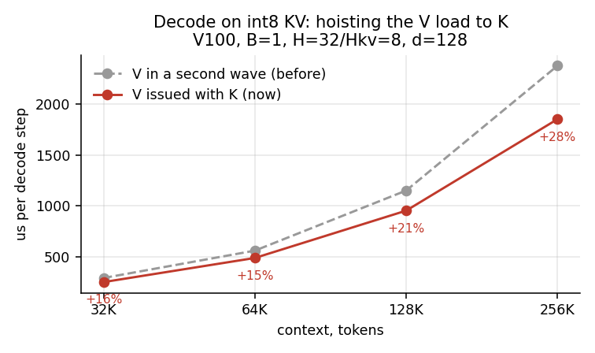
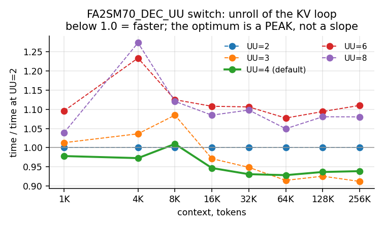
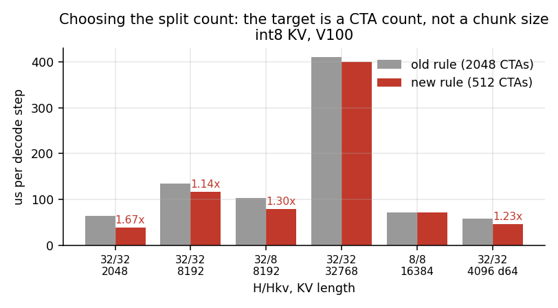
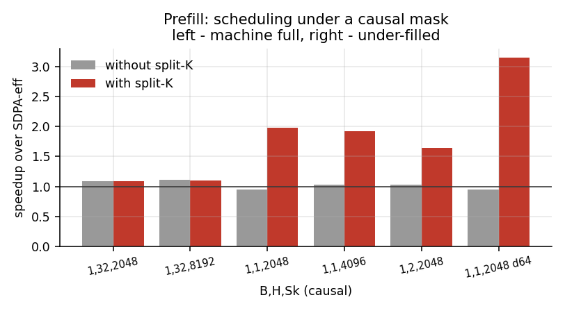
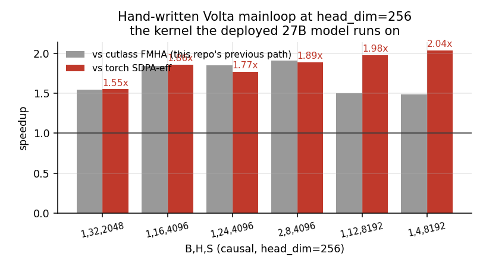
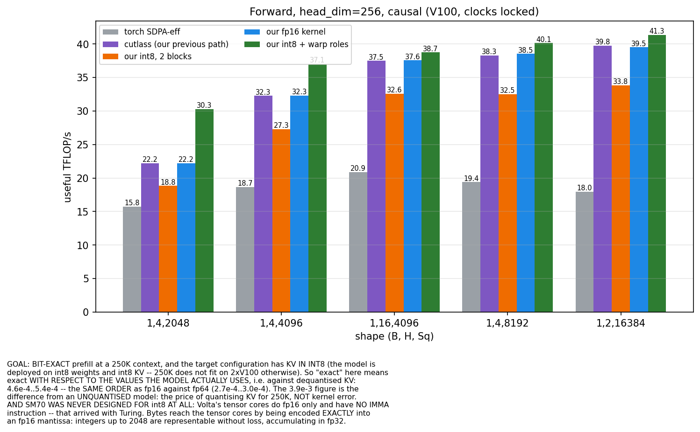
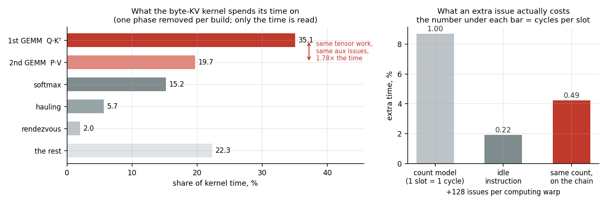

# HOOLIGAN — a kernel class for inference engines on NVIDIA Volta (`sm_70`)

> *"The absurdity of a local move is a SEARCH SIGNAL."*


An importable PyTorch package carrying a **whole compute layer for an inference engine** on hardware
the ecosystem wrote off: attention in all three regimes (prefill, decode, training), the gated-delta
linear scan, quantised-weight paths (GPTQ-int8, MXFP4), and paged KV-pool servicing. Modern
FlashAttention (`sm_80+`) and FlashInfer (`sm_75+`) do not run here at all, and the stock
PyTorch/vLLM path refuses half the modern formats — so several rows below are not "faster", they are
the difference between running and not running.

Every kernel is exact and verified against an fp32 exact-softmax oracle; the non-obvious algorithms
are derived below with proofs and independent verification recipes.

**The method travels further than the kernels.** What is written down in `docs/` is not a changelog:
it is how to find the resource that actually binds a kernel on a given machine, and then bully
exactly that one — issue-slot accounting and the boundary where it stops predicting
([`VOLTA_SM70.md`](docs/VOLTA_SM70.md) §3b), falsifier decomposition, the "free things first" ladder,
the catalogue of where the toolchain diverges from the hardware. None of it is Volta-specific.

**Start here:** [`docs/KERNELS.md`](docs/KERNELS.md) — what each kernel is, what it is for, how to run it.

<details>
<summary><b>Why "HOOLIGAN"</b></summary>

Because every move that worked here looks, taken alone, like a breach of good manners — which is
exactly why nobody had made it. The absurdity of a local move turned out to be not a
contraindication but a **search signal**: where a well-behaved engineer says "you don't do that",
that is usually where the unclaimed resource sits.

- `sm_70` has **no int8 tensor instruction**. The polite answer is "int8 on Volta is impossible". The
  hooligan answer is to encode the byte **into an fp16 mantissa** (`0x6400 | u` *is* `1024 + u`) and
  fold the constant offset into a rank-1 correction. Result: a byte kernel **faster than the fp16
  kernel** on hardware that has never heard of int8.
- The tail key tile was reading past the end of the tensor. The polite answer is a predicated load.
  Measured: **−7.7% speed**. The hooligan answer is to **clamp the address onto a knowingly wrong but
  valid row** — its contribution is exactly zero, so any finite number will do. One integer
  instruction, zero loss.
- Twelve warps in a block do **different work**: four only haul, eight only compute. The polite answer
  is "warps should be symmetric". Measured: **1.22–1.46×** over the symmetric arrangement.
- A direct check **refuted our own doctrine**: we had written down "the kernel is past the issue wall,
  every instruction costs a cycle", and an idle instruction priced it at **0.22 cycles**. Hooliganism
  only works together with the second rule — **measure mercilessly**; without it, it is just nerve.

The method in one line: **name, by measurement, the resource that actually binds — then bully exactly
that one.** Everything else in `docs/` is tooling for the first half of that sentence.

</details>

**English** | [Русский](README.ru.md)

## Beyond speed: formats Volta simply did not have

Several rows below are not "faster" — on `sm_70` they are the difference between running and not
running. The middle column is what stock vLLM/PyTorch does on this hardware.

| capability | stock path on V100 | here |
|---|---|---|
| **MXFP4 weights** (gpt-oss) | **refused**: `mxfp4 is not supported ... Minimum capability: 80` | **works** — own bit-exact unpacker, plus a fused GEMV that consumes the weights packed |
| **8-bit KV cache** (`fp8_e4m3`) | **refused** by the Triton backend: `type fp8e4nv not supported in this architecture` | **works**, and it is where the decode margin is largest |
| **int8 / int4 KV** | none | decode: `quantize_kv`, int8 ≈ 0.7% error. Prefill: a byte-KV kernel at `d=256` **faster than the fp16 one** (§3) although `sm_70` has no int8 tensor instruction — and its shipped store format (biased byte + interleaved scales) also beats the `e5m2` route while carrying 7.8× its accuracy |
| **bf16 input** | SDPA's efficient backend rejects it | accepted (cast to fp16) |
| **head_dim > 256** | flash needs sm_80+, SDPA is limited | up to **1024** for prefill, 512 for decode/backward |
| **head_dim % 8 ≠ 0** | SDPA's efficient backend rejects it | zero-padded, runs |
| **sliding window** | no fused path → an `[S,S]` mask and the MATH backend | fused, `O(Sk·W)`, **24×** the fallback |
| **two-sided window** | none | fused, **27×** |
| **logit soft-cap** (Gemma) | **inexpressible** — a nonlinearity, no additive-mask form | fused |
| **ALiBi** | materialised mask | fused, **13×** |
| **training** (`dQ/dK/dV`) | — | exact backward, head_dim ≤ 512, reproducible dropout |
| **paged KV + varlen** | — | block table, `cu_seqlens` |
| **GQA/MQA** | K/V expansion | native, no expansion |

**20/20** correctness suites pass on V100 (`tests/run_all.py`); every kernel is checked against an
fp32 oracle.

---

## Speed: where it comes from

- **Prefill** (exact, `sm_70` tensor cores): faster than `scaled_dot_product_attention` on **every**
  measured shape. At `head_dim ≤ 128` the inner loop is cutlass's and the win is how causal work is
  **scheduled** across 80 SMs (§2.6) — **1.07–1.10×** when many heads already fill the machine,
  **1.64–3.15×** when they do not. At `head_dim = 256` the inner loop is **ours**: a hand-written
  Volta mainloop (§2.7) replaces cutlass entirely and runs **1.55–2.04×** over SDPA-eff at 40–47% of
  the achievable roofline. And when the KV cache is **byte-wide** — the configuration a 250K context
  forces on 2×V100 — a warp-role kernel at `d=256` reaches **1.94–2.35×** over SDPA-eff, beating even
  our own fp16 kernel by 1.02–1.34× on hardware that has **no int8 tensor instruction** (§3).
- **Decode** (split-KV, a kernel V100 never had): **3.0–11.3×** over SDPA-eff on fp16 and
  **4.1–15.9×** on int8, bit-exact (`relL2 ≤ 1e-6`).
- **Training**: exact backward, isolated **1.02–1.06×** at d=512, **1.12–1.69×** at d=256 and
  **1.16–1.31×** at d=128 (that last pair of shapes was not part of this re-measurement pass).

### Decode against context (the 32K–256K operating range, int8 KV)



`V` was issued in a second, later wave although it depends on nothing computed. Issuing it alongside
`K` doubles the outstanding loads per warp: **+16% at 32K and +28% at 256K**, and the gain grows with
length. The arithmetic does not move, so the result is bit-identical.

### Switchable kernel parameters



The optimum is a **peak, not a slope**: the unroll costs `UU×EPT` registers, so both `UU=1` and
`UU=6` lose to the middle. And it is **shape-dependent** — a `UU=4` tuned at `d=128` cost a real
`d=256` model 10% — so the default derives from `EPT` while the knobs stay: `FA2SM70_DEC_UU`,
`FA2SM70_DEC_VK`, `FA2SM70_DEC_GF`, `FA2SM70_DEC_PF`.

### How many splits: the target is a CTA count, not a chunk size



Five of six shapes want 16 splits and the sixth wants 64 — and in **all six** the product
`B·H·splits` is 512, about 6.4 CTAs per SM. The previous rule aimed at 2048 CTAs and over-split
fourfold.

### Prefill: scheduling under a causal mask



With many heads the machine is already full and block ORDER is what is left. With few, the schedule
is pinned by its **longest task**, and splitting that task over keys pays multiples. The bar below
1.0 is the shape (`d=64`) that **lost** to torch before this work.

---

```python
import torch, fa2_sm70

# prefill (exact), Q [B,H,Sq,D] fp16, K/V [B,Hkv,Sk,D] fp16 (GQA/MQA ok)
O, lse = fa2_sm70.attention(Q, K, V, causal=True)

# training: differentiable exact attention (autograd dQ/dK/dV), head_dim <= 512
O = fa2_sm70.flash_attn_func(Q, K, V, causal=True); O.sum().backward()

# decode step (Sq==1), exact fp16
O, lse = fa2_sm70.decode(q, K, V)                      # q [B,H,1,D]

# prefill at head_dim=256 on a BYTE KV cache (250K contexts; format 8, see docs/KERNELS.md)
cache  = fa2_sm70.quantize_kv_prefill(K, V)              # K/V [B,Hkv,Sk,256] -> byte store + scales
O, lse = fa2_sm70.prefill_bytes(Q, cache, causal=True)   # Q/O [B,Sq,H,256] fp16 (BSHD)

# decode with an int8 (or int4) KV cache (quantize once, decode many)
cache = fa2_sm70.quantize_kv(K, V, bits=8)             # bits=4 -> robust 2-level int4
O, lse = fa2_sm70.decode_quantized(q, cache)
```

---

## 1. Install / build / import

**Pinned/tested toolchain** (a one-time preflight checks these and, on a build failure, prints an
actionable hint + this recipe rather than a raw nvcc dump):

| component | tested / required |
|---|---|
| GPU | `sm_70` (V100); newer archs build via `TORCH_CUDA_ARCH_LIST` but tuning is for Volta |
| CUDA toolkit | 12.x `nvcc` that still supports `compute_70` (set `CUDA_HOME`) |
| host compiler | gcc **≤ 14** (CUDA 12.8 rejects newer) — pin `CC`/`CXX`/`CUDAHOSTCXX` to `/usr/bin/g++` |
| PyTorch | 2.5–2.7 `+cu12x`, built with `sm_70` support |

```bash
git clone git@github.com:xormal/V100-SM_70-Flash-Attn-2-v1.git
cd V100-SM_70-Flash-Attn-2-v1
export CC=/usr/bin/gcc CXX=/usr/bin/g++ CUDAHOSTCXX=/usr/bin/g++   # nvcc-compatible host compiler
pip install -e .                       # editable; the bundled cutlass headers in ./fa2_src stay in place
# or use it in place without installing:
python -c "import sys; sys.path.insert(0,'.'); import fa2_sm70; print('ok')"
```

The three CUDA extensions (prefill, backward, decode) **JIT-compile for `sm_70` on first use** (cached
under `fa2_sm70/_build`, override with `FA2SM70_BUILD_DIR`); the first `attention`/`decode`/backward
call therefore takes a while, subsequent ones are instant. The prefill/backward kernels are built from
the bundled cutlass FMHA sources in `fa2_src/` — no network, no outer repo.

### API
| function | purpose |
|---|---|
| `attention(Q, K, V, causal=False, scale=None, window=0, softcap=0.0, alibi_slopes=None, window_right=-1) -> (O, LSE)` | exact prefill; O fp16 `[B,H,Sq,D]`, LSE fp32 `[B,H,Sq]`. `window>0` = causal sliding-window (keys `[i−W+1, i]`, `O(Sk·W)`); `window_right≥0` makes it **two-sided/bidirectional** (keys `[i−(W−1), i+window_right]`, `causal=False`); `softcap>0` = Gemma-style logit soft-cap `cap·tanh(logit/cap)`; `alibi_slopes[H]` = per-head linear position bias `slope·(key−query)`. Native GQA/MQA (no K/V expansion) |
| `flash_attn_func(Q, K, V, causal=False, scale=None, dropout_p=0.0) -> O` | **differentiable** exact attention (autograd `dQ/dK/dV` via the cutlass FMHA backward), **head_dim ≤ 512** (Gemma-4 d=256/512 fine-tuning); optional reproducible attention dropout (dropout head_dim ≤ 128). For training |
| `attention_varlen(Q, K, V, cu_seqlens_q, cu_seqlens_k, max_q, max_k, causal=False, scale=None) -> (O, LSE)` / `flash_attn_varlen_func(...)` | variable-length / packed (ragged batches, no padding); `cu_seqlens` `[nseq+1]` int32. `attention_varlen` forward is head_dim ≤ 512; the `flash_attn_varlen_func` form is differentiable (head_dim ≤ 512) |
| `decode_paged(Q, Kcache, Vcache, block_table, block_size, kv_len, scale=None, seqlens=None) -> (O, LSE)` | paged decode: K/V in a block pool `[num_blocks, block_size, Hkv, D]`, `block_table [B,max_blocks]` maps logical→physical blocks; `seqlens[B]` for per-sequence lengths (vLLM-style serving) |
| `decode(q, K, V, scale=None, kv_dtype='fp16'\|'int8'\|'int4', deferred=True, num_splits=None, k_absmax=None, mqa='auto') -> (O, LSE)` | one decode step, `Sq==1`; O fp32. `mqa='auto'` fuses shared-KV heads (MQA/GQA) so KV is read once: **bit-exact, 1.4–1.6× at large KV (d=512/long ctx)**, neutral otherwise |
| `quantize_kv(K, V, bits=8, per_channel=None) -> cache` (dict) | quantize a KV cache once; int4 defaults to 2-level per-channel |
| `mxfp4_dequant(blocks, scales, dtype=fp16) -> T` | **MXFP4 (OCP Microscaling) on Volta**, which no other path offers: `blocks` uint8 `[..., nblk, 16]` (16 bytes = 32 nibbles = one MX block), `scales` uint8 `[..., nblk]` (E8M0). Bit-exact against the reference on all 256 byte values and on real gpt-oss weights |
| `decode_quantized(q, cache, scale=None, deferred=True) -> (O, LSE)` | decode from a pre-quantized cache (serving pattern) |
| `KVCache(B, Hkv, max_len, D, device)` — `.append(k,v)`, `.decode(q, scale=None) -> (O, LSE)` | stateful incremental KV cache: append new tokens, decode over the valid prefix; maintains the deferred-U scan incrementally (no per-step rescan); native MQA/GQA |
| `latent_attention(qt, C, causal=False, scale=None, B=None) -> (O, LSE)` | low-rank/MLA attention in the compressed latent (run at head_dim=r ≪ d); **4.5–42× over full-d when r<d** |
| `mla_attention(Q, C, Wk, Wv, causal=False, scale=None) -> (O, LSE)` | full MLA over a shared latent: **prefill decompresses to d_h** (fast d_h kernel), **decode absorbs** (reads latent once). **decode 3.3–4.1× over SDPA**, prefill matches vendor d_h at 4× smaller cache |

**Head-dim (`D`) limits per path** (ground truth = the dispatch in
`fa2_sm70/csrc/attn_fwd_cutlass.cu` / `fa2_sm70/__init__.py`; `D` is zero-padded up to the next
supported value, so *any* `D ≤ the max* is accepted):

| path | function(s) | max `D` | supported tiles (pad-up targets) |
|---|---|--:|---|
| prefill (+ window / softcap / ALiBi) | `attention` | **1024** | 64, 128, 256, 512, 768, 1024 |
| decode (+ softcap / ALiBi) | `decode`, `decode_paged`, `KVCache`, `decode_quantized` | **512** | 64, 128, 256, 512 |
| backward (autograd) | `flash_attn_func` (`dropout_p=0`) | **512** | 64, 128, 256, 512 |
| varlen fwd + bwd | `attention_varlen`, `flash_attn_varlen_func` | **512** | 64, 128, 256, 512 |
| dropout (train fwd+bwd) | `flash_attn_func` (`dropout_p>0`) | **128** | 64, 128 |

(Prefill reaches 1024 via the cutlass output-accumulator path; decode/backward/varlen top out at 512;
dropout at 128. Everything above 128 is exact but off the register-resident fast path.)

`LSE = log Σ_j exp(scale · q·kⱼ)` (natural log), the quantity FlashAttention's backward and
split-KV/paged paths consume. In a real serving loop, maintain `k_absmax` (a running max of `‖kⱼ‖`)
and the quantized cache incrementally as tokens are appended — do **not** recompute them per step.

A **flash-attn-compatible** layer is in `fa2_sm70.flash_attn_interface` (`flash_attn_func`,
`flash_attn_qkvpacked_func`, `flash_attn_kvpacked_func`, `flash_attn_varlen_func`) using the flash-attn
`[B, S, H, D]` layout and argument names (`window_size=(left,0)`, `softcap`, `alibi_slopes`,
`dropout_p`) — a mostly drop-in swap that keeps this package's explicit `sm_70` limits (unsupported
combos raise rather than silently emulate). Correctness suites: `python tests/run_all.py` (GPU matrix)
and `python tests/test_smoke_cpu.py` (no-GPU API check).

---

## 2. Why these algorithms — the mathematics

Notation: query `q`, keys/values `kⱼ, vⱼ ∈ ℝ^d`, score `sⱼ = scale·⟨q,kⱼ⟩`, softmax weight
`wⱼ = e^{sⱼ}`, output `O = Σⱼ wⱼ vⱼ / Σⱼ wⱼ`. The non-obvious mathematical steps are
reproduced with proofs here.

### 2.1 Exact attention via online softmax (prefill + the flash-decoding backbone)
Computing `O` without ever materialising the `Sq×Sk` score matrix uses the **online-softmax**
recurrence: stream the keys in tiles, keep a running max `m`, running denominator `ℓ`, and running
output `acc`; when a tile's max exceeds `m`, rescale `(acc, ℓ) *= e^{m_old−m_new}`. This is
algebraically identical to the batched softmax (a telescoping of the rescales) → **exact**. The
prefill path builds this on NVIDIA cutlass's Volta FMHA kernel (`AttentionKernel<half_t, Sm70,…>`,
the same `fmha_cutlassF_sm70` that `SDPBackend.EFFICIENT_ATTENTION` dispatches to), whose integrated
`MmaVoltaTensorOp` pipeline is the per-block ceiling on Volta (~14–16% of the 125-TFLOPS tensor
roofline at full occupancy; attention is intrinsically low-utilisation because of the softmax and the
15%-occupancy geometry cap).

**The inner loop is the vendor's; the schedule is not.** Eight hand-optimisation levers *inside* the
mainloop (warp-specialisation, block-double-buffering, P-in-registers, vectorised loads, …) were built
and measured, and each is blocked by a Volta resource limit (no `cp.async`, no `ldmatrix`,
register/occupancy caps) — a hand-written Volta mainloop reaches 96.8% of `HMMA` peak in isolation yet
still loses to the tuned cutlass pipeline in situ. So we do not fight it there. The wins come from
**how the work is laid out across the 80 SMs**, which the vendor kernel does naively (§2.6): a causal
mask makes query tiles wildly unequal in cost, and the vendor both dispatches them worst-first and
never splits them. Fixing the schedule is exact by construction — it changes *which block computes
what*, not the arithmetic — and it is worth a few percent when the machine is full and **1.7–3.3×**
when it is not.

### 2.2 Split-KV flash-decoding (decode, `Sq==1`)
At decode `Q·Kᵀ` is a **GEMV**, not a GEMM: memory-bound, and a single query row gives only `B·H`
thread-blocks — far too few to fill 80 SMs, so the prefill kernel is parallelism-starved (it
streams the whole KV serially per block). **Flash-decoding** splits the `Sk` keys into `num_splits`
chunks handled by `num_splits·B·H` blocks concurrently; each emits a chunk-local `(Oc, LSEc)`; a
second kernel combines them with the *same* online-softmax across splits:

`m = maxc mc,  ℓ = Σc e^{mc−m} ℓc,  O = Σc e^{mc−m} ℓc Ôc / ℓ`.

Exact (the cross-split combine is the softmax's associativity), and it recovers the parallelism →
the multi-× decode speedups. **Verified**: `tests/test_decode.py` shows fp16 online/deferred
`relL2 ≤ 1e-6` vs the fp32 reference.

### 2.3 Deferred rescale — removing the serial dependency (the decode default)
The online rescale is a strictly-ordered recurrence (`acc` at key `j` depends on key `j−1`), which
throttles instruction-level parallelism. We remove it with a **certified upper bound** `U ≥ maxⱼ sⱼ`.

**Invariance (proof).** For any `U`,
`Σⱼ e^{sⱼ−U} vⱼ / Σⱼ e^{sⱼ−U} = e^{−U}Σⱼ e^{sⱼ} vⱼ / (e^{−U}Σⱼ e^{sⱼ}) = O`.
The common factor `e^{−U}` cancels, so **`O` is exactly independent of `U`** — a loose `U` changes
only the common scale, never the ratio. ∎ Consequently `(Σ wⱼvⱼ, Σ wⱼ)` accumulate under plain `+`
(a commutative monoid): **no running max, no rescale, any reduction order** — full ILP, and the
split-combine becomes a plain sum.

**The bound.** Cauchy–Schwarz gives the cheap certified `U = scale·‖q‖·maxⱼ‖kⱼ‖ ≥ sⱼ` (the
`maxⱼ‖kⱼ‖` is a per-KV running max). **Numerical safety**: a term underflows only if `sⱼ − U < −E`
(`E ≈ 88` for fp32). The flushed softmax mass is `≤ n·e^{Δ−E}` where `Δ = U − max sⱼ`, so the induced
error is `≤ ε` when `Δ ≤ E − ln(n/ε) ≈ 69` for `n = 65536, ε = 2⁻¹¹` — the loose Cauchy–Schwarz `U`
is comfortably inside this, and by the invariance the ratio is exact regardless. **Result**: fp16
deferred is bit-exact and **1.04–1.8× faster than online** (biggest where the serial chain, not the
memory, dominates). We *proved* it's the serial chain (not the exponential) by first replacing the
SFU `exp` with a polynomial (FMA) — that was neutral; removing the rescale was the win.

### 2.4 int8 / int4 KV — reading fewer bytes (the only way past the bandwidth ceiling)
Decode is HBM-bandwidth-bound on **every** GPU (FlashInfer included), so beating the exact ceiling
means **reading fewer bytes**. Per-token symmetric quantization stores each `kⱼ,vⱼ` in `t` bits about
one scale ⇒ `int8` reads ½, `int4` reads ¼ the bytes.

**How the error propagates (exact identity).** With `ŵⱼ = wⱼ e^{δⱼ}` (log-weight error) and value
error `ηⱼ`, and `πⱼ = wⱼ/Σw`:
`Ô − O = Cov_π(δ, v)/(1 + E_π[δ]) + E_π[η]`.
Two consequences: **(i)** any *key-independent* part of `δ` cancels in the normalisation — a per-key
scale is free, and only the key-to-key *dispersion* of the rounding error bites; **(ii)** values
enter linearly and π-averaged (no exponential amplification), so `V` tolerates ~`scale·R` × cruder
treatment than `K`. Quantitatively `ε ≈ scale·R·2^{−t}` — halving per bit. **Verified** (`bench`):
`int8` gives `relL2 ≈ 7·10⁻³` (≈0.7%, standard production-KV-quant quality; the deferred sum adds
**no** further error), consistent with `ε ∝ 2^{−t}`.

**int4 — 2-level (per-channel × per-token) is the default.** Real LLM K/V have a few *outlier
channels* (huge-magnitude dimensions) that dominate a single per-token scale and wreck int4
(`relL2 ≈ 0.32`). Consequence **(i)** above says the fix is free: a per-channel key scale cancels in
`⟨q,k⟩` (fold it into the query, `q' = q ⊙ s_chan^K`) and a per-channel value scale is a post-multiply
on the output (`O = Õ ⊙ s_chan^V`) — so `quantize_kv(..., bits=4)` stores `q(K/s_chan)`, and
`decode_quantized` applies the two scales with **no kernel change**. **Verified**: on outlier-channel
data int4 improves `0.32 → 0.15` (**2.1×**); on clean Gaussian data it's unchanged (`0.13`). int4
is still ~12–15% (V-quantization-limited when attention is diffuse), so **int8 remains the practical
choice**; int4 pays off only for spiky-attention heads, where the kernel's exact top-1 control point
(argmax key re-read in fp16, `flash_decode_q` with `Kf/Vf`) drives error `<1%`.

### 2.5 The moment form — O(1)-per-query decode for bounded scores (research preview)
Expanding `e^{sⱼ} = Σ_m sⱼ^m/m!`, the softmax average is a ratio of **moments** `S_m = Σⱼ sⱼ^m`,
`T_m = Σⱼ sⱼ^m vⱼ`. Crucially these factor through the query:
`S_m = scale^m ⟨q^{⊗m}, Σⱼ kⱼ^{⊗m}⟩` with `Σⱼ kⱼ^{⊗m}` precomputed **once** per KV set. Then each
query costs `O(Σ_{m≤M} d^m)` with **zero per-key work — O(1) in the context length `n`**. Accuracy
needs `M ≈ 1.086·R` (score range `R`); at `M=2` (viable for `R ≲ 1.3`, e.g. temperature-scaled or
low-score heads) the amortised tensor form is *exactly* the degree-2 form (verified in
`../..` prototype). For 100k+ context with bounded scores this is asymptotically unbeatable (every
other method is `O(n)`). Shipped as a prototype (`decode` kernel is future work); the concept and
its accuracy frontier are documented for completeness.

### 2.6 Scheduling a causal mask across 80 SMs (prefill; exact by construction)
Under a causal mask the query tiles are **wildly unequal**: tile `i` scans `⌈((i+1)·kQ + off)/kK⌉` key
tiles, so with `kQ=32, kK=128, S=2048` the weights run `1 … 16` — the last tile costs 16× the first.
Two independent facts follow, and the vendor kernel exploits neither.

**(a) Order — put the heavy tiles first.** The dispatcher hands blocks out by ascending `blockIdx`, so
the *ragged tail* of the last wave receives the **largest** `q0`, i.e. maximum work on an almost-empty
machine. Reversing the mapping (`q0 = gridDim.x−1−blockIdx.x`) is longest-processing-time-first, which
is the classical greedy-schedule heuristic, and costs one subtraction. Blocks are independent (each
writes its own rows), so the result is untouched. Measured: **+19.6% at `S=4096`, +29.8% at `S=8192`**
on the isolated kernel; a few percent once many heads already fill the machine.

**(b) Splitting — order alone is not enough.** A schedule can never be shorter than its **longest single
task**. With `B·H·(S/kQ)` blocks over `slots = SMs × blocks-per-SM`, the floor is
`max(Σwᵢ/slots, max wᵢ)`. At `S=2048, B·H=1`: `Σw = 544`, `slots = 240` ⇒ ideal `2.27`, while
`max w = 16` — a **7× imbalance no ordering can fix**. Measured cost: 130 µs/head against 31 µs/head at
`H=32`, i.e. **4.1× overpaid**.

The fix must split **keys**, not queries: halving `kQ` doubles the block count but the last tile still
scans every key, so `max w` is unchanged while the ideal drops — the imbalance gets *worse*. Splitting
the (causally-trimmed) key range of each query tile into `s` slices gives partial `(Oc, LSEc)` pairs
that recombine by the same identity as §2.2,
`m = maxc mc, ℓ = Σc e^{mc−m}ℓc, O = Σc e^{mc−m}ℓc Ôc / ℓ` — **exact**, with fp32 partials so the merge
adds no error (`relL2` is identical to the unsplit path). `s` is chosen as the smallest value with
`max w / s ≤ ideal`.

**When not to split.** The combine costs `(s+1)·B·H·Sq·d·4` bytes *regardless of how heavy the tiles
are*, so it only pays when the tiles are heavy. Two shapes with the same block count (256 vs 240 slots)
and near-identical imbalance went opposite ways — `1,1,8192,128` **+37%**, `1,4,2048,128` **−4%** — and
what separates them is the **average tile weight** (32.5 vs 8.5 key tiles): the combine was 2.5% of the
kernel in one case and 9% in the other. The planner therefore declines to split when
`blocks > 0.9·slots` **and** `avg w < 16`, which is why the full-machine rows below are untouched.
Off-switches: `FA2SM70_FWD_SPLITS=1`, `FA2SM70_FWD_REV=0`.


### 2.7 The hand-written Volta mainloop, and the tile laws it exposed (`head_dim = 256`)
Everything above rides on CUTLASS. At `head_dim = 256` that stops being enough, and not because of a
missing optimisation: `mma_tensor_op_sm70.h:136` asserts `Shape % GemmShape<32,32,4>` because
CUTLASS's Volta operand layouts are *organised* in 32×32 interleaved tiles, and
`pitch_linear_thread_map.h:298` rejects a 256-wide key tile with "Number of iterations must be
non-zero". Both are metaprogramming limits, not hardware ones — a 32×16 tile is simply two
`m8n8k4` quad-pair operations. So the mainloop is written by hand
(`fa2_src/fmha_kernel/gemm/volta_warp_mma.h`, `fa2_sm70/csrc/volta_fwd_block.cuh`).

**The instruction, as measured.** `mma.sync.aligned.m8n8k4` issues **per quad pair**, not per warp:
quad pair `p` owns lanes `{4p..4p+3} ∪ {4p+16..4p+19}`, and a warp's four quad pairs run four
*independent* 8×8×4 products. Feeding it "lane `l` supplies row `l` of A and column `l` of B" therefore
computes the four **diagonal** 8×8 blocks of a 32×32 — 256 of 1024 cells. The first version of this
header did exactly that and **passed a value check against torch**, because a value check compares the
cells the map names, which are the cells a partial walk computes. Coverage is asserted with an atomic
stamp per output cell instead (`tests/test_volta_hmma.py`).

**Tile law 1 — the warp count is bounded by the query tile.** Operand A (the `Q` tile) has exactly one
contiguous vector iteration in the raked thread map, so all warps must fit along *strided*:
`warps ≤ kQ/8`. With `warps = (kQ/32)·(kK/WarpN)` that is exactly **`WarpN ≥ kK/4`**. A hard-coded
`WarpShape<32,32>` satisfies it up to `kK = 128` and divides `1/2 = 0` at 256 — which is the CUTLASS
error above, an integer division reaching zero rather than an unsupported shape.

**Tile law 2 — the pipeline's register tax is `(BK·D/8)/threads` per thread.** Staging a key tile
through registers costs one vector per thread per stage, so the tax is *inversely* proportional to the
thread count: measured 124 → 168 registers at 4 warps (+44) and 124 → 234 at 2 warps (+110) for the
same tile.

**Partial (dosed) tile fill — the lever that follows from law 2.** The pipeline does not have to be
all-or-nothing. Of the `kStage` vectors a tile needs, only `PS` are routed through registers (their
`LDG` issued early); the remainder are loaded and stored in place. The freed registers then pay for
holding `Q` fragments across the whole query block, which is the one preload that measurably pays
(+16%) and which had been clipped by exactly this budget — it broke off between 28 and 32 k-groups.
The same shape of trick applies to the tile itself: a 64-wide load can be filled by **three** 16-wide
sub-tiles with the fourth discarded when the fourth would only add register pressure. Both are
"fill the tile partially, on purpose", and both are chosen by measurement, not by symmetry.

**Tile law 3 — loads-per-MMA cannot be optimised apart from registers.** `ncu` named the limiter
correctly (L1/shared pipe at 61.6% against 38% tensor, i.e. operand loads per MMA) and the obvious
move — the densest feed — **lost**:

| warp tile | loads/MMA | registers | spill | `S=8192, H=4` |
|---|--:|--:|--:|--:|
| 32×32 | 1.00 | 254 | 16 B | 4.752 ms |
| **32×16** | **1.50** | **178** | **0** | **3.663 ms** |
| 16×16 | 2.00 | 182 | 0 | 4.400 ms |
| 16×32 | 1.50 | 204 | 0 | 5.964 ms |

This is the three-way Volta trade-off (`docs/VOLTA_SM70.md`): occupancy, traffic and loads-per-MMA

> **Where the toolchain diverges from the machine:** [`docs/COMPILER_VS_HARDWARE.md`](docs/COMPILER_VS_HARDWARE.md)
> (Russian) catalogues every measured case where nvcc / ptxas / cutlass do something other than what
> the hardware model implies — the `__launch_bounds__` register ceiling and the silent spill taken to
> meet it, local memory that is not spill, constant memory serialising on divergent lanes,
> `--use_fast_math` flushing a legitimate subnormal, and cutlass "walls" that turn out to be integer
> divisions reaching zero. Each entry carries its detection recipe and its measured cost.
cannot all be maximised, and a profiler naming one axis does not name the *direction* along it.

Shipped configuration: `BQ=64, BK=64`, 8 warps (2×4), warp tile 32×16, `K` fed in `DC=64` chunks by a
software DMA, reversed block order — 178 registers, no spill, 84 KB shared. Neighbourhood, measured:
`DC=32` → 3.760 ms, `DC=128` → 3.723, 128-bit wide loads → 3.944, padding instead of swizzle → 4.828,
no block-order reversal → 3.988. Off-switch: `FA2SM70_NO_VOLTA_FWD=1`.


---

## 3. How it's verified — and how to check independently

Every claim above is reproducible on your own V100:

```bash
python tests/run_all.py            # full GPU matrix: 20 correctness suites, prints pass/fail (20/20 on V100)
python tests/test_smoke_cpu.py     # no-GPU import + API-surface + signature check (CI-safe)
#   the 20 suites (also runnable individually):
python tests/test_mxfp4.py        # MXFP4 E2M1/E8M0 unpacking vs bit-exact reference
python tests/test_attention.py     # prefill: O & LSE vs an fp32 exact-softmax oracle (max err < 5e-4 / 5e-3)
python tests/test_decode.py        # decode: fp16 BIT-EXACT (relL2 <= 3e-3), int8 ~0.7%, cache-path == internal
python tests/test_backward.py      # autograd dQ/dK/dV vs fp32 (MHA/GQA/MQA, causal, Sq!=Sk, d<=512)
python tests/test_varlen.py        # cu_seqlens forward + backward (ragged, d<=512)
python tests/test_dropout.py       # reproducible Philox dropout (p=0 no-op, unbiased scaling)
python tests/test_paged.py         # paged block-table decode (uniform + per-sequence seqlens)
python tests/test_alibi.py         # per-head ALiBi position bias
python tests/test_window.py        # sliding + two-sided/bidirectional local window (causal & non-causal)
python tests/test_quant_cache.py   # stateful int8/int4 KV cache, bit-exact vs one-shot quantize
python tests/test_decode_mod.py    # decode-path softcap + ALiBi (online path)
python tests/test_fa_interface.py  # flash-attn-compatible [B,S,H,D] wrappers
python tests/test_volta_hmma.py    # hand-written Volta HMMA operand-map coverage
python tests/test_volta_fwd.py     # hand-written d=256 forward, fp16 AND int8-KV paths, vs fp32 reference
python tests/test_gptq_dequant.py  # GPTQ int8 weight unpack vs explicit reference
python tests/test_w8a16.py         # fused packed W8A16 GEMV vs reference
python tests/test_vllm_i8_gather.py # paged->int8 gather (bit-exact) + the byte prefill route
# benchmarks (latency, % roofline, speedup, relL2):
python benchmarks/bench_prefill.py # ours vs SDPA (default) vs SDPBackend.EFFICIENT_ATTENTION
python benchmarks/bench_decode.py  # decode variants vs SDPA / EFFICIENT_ATTENTION
python benchmarks/bench_decode_lengths.py  # decode tok/s vs context length (512..32k), ours vs SDPA-eff
python benchmarks/bench_train.py   # forward vs forward+backward vs SDPA-efficient fwd+bwd
python benchmarks/bench_modes.py   # window/two-sided/ALiBi/softcap: modes SDPA has no fused path for
# end-to-end: run a real Gemma model with THIS kernel as the attention backend (prefill/decode tok/s + Q&A)
MODEL=/path/to/gemma-4-12B-it python examples/run_gemma_fa2_sm70.py   # see REPRODUCE.md
# head-to-head vs real FlashAttention-2 on the model's own shapes (see RESULTS_gemma4_A100_vs_V100.md)
ATTN=fa2_sm70 python benchmarks/kbench_sliding.py                     # ours (V100); ATTN=flash on an A100
```

The separate [`E2E_TRAINING_REPORT.md`](E2E_TRAINING_REPORT.md) records a historical external
optimizer-loop validation for compact GPT-3-style and Llama-3-style models at head dimensions 64,
128, 256, and 512. Its performance values apply to its recorded source snapshot; the current
microbenchmark results are the tables below.

- **Independent oracle**: the tests compare against `softmax(scale·Q·Kᵀ) · V` computed in fp32 with
  plain PyTorch (`exact_ref` in `benchmarks/_common.py`) — no shared code with the kernels, so a
  bug in the kernel cannot hide.
- **Independent baselines**: the benchmarks force `torch`'s own attention onto both its default
  dispatch and the memory-efficient (cutlass) backend via `torch.nn.attention.sdpa_kernel(
  SDPBackend.EFFICIENT_ATTENTION)`.
- **The proofs** in §2.3–2.4 are self-contained (one line of algebra each); the numerical claims
  (`ε ∝ 2^{−t}`, deferred == online) are printed by the benchmarks so you can confirm the constants.

### Measured

V100-SXM2-32GB, driver 580.159.03, `torch 2.7.0+cu126`, fp16, best `num_splits`; **re-measured
2026-07-31 with clocks locked at 1530 MHz** on an otherwise idle card (the foreign-process count is
printed before and after every run). Reproduce with `benchmarks/`. Point measurements, not
guarantees.

**`%rf` is against the MEASURED 93.6 TFLOP/s HMMA ceiling, not the 125.3 on the spec sheet.** 125.3
assumes the boost clock and perfect issue; a dense fp16 GEMM on this card tops out at 93.6
(`docs/VOLTA_SM70.md`, `[spec]` vs `[measured]`). Quoting against the spec number deflates every row
by 1.34× and makes a kernel at 60% of what the card can actually do look like 45%.

**Prefill**, causal. Three exact levers separate us from the same
CUTLASS `fmha_cutlassF_sm70` kernel SDPA-eff dispatches to: the **BHSD-direct** output (`kOutputBHSD`,
skipping the vendor's BSHD-then-`permute().contiguous()` copy of `O`), the **causal block-order
reversal**, and **causal split-K** (§2.6). The `no-split` column is split-K switched off
(`FA2SM70_FWD_SPLITS=1`) — `bench_prefill.py` produces it in a child process, so one command reproduces
both sides:

| B, H, Sk, d | ours | no-split | SDPA | SDPA-eff | ours %rf | ours/eff | relL2 |
|---|--:|--:|--:|--:|--:|--:|--|
| *full machine — split-K stays off* ||||||||
| 1, 32, 1024, 128 | 0.280 ms | 0.281 | 0.300 | 0.300 | 32.7% | **1.07×** | 2.6e-4 |
| 1, 32, 2048, 128 | 0.947 ms | 0.944 | 1.034 | 1.031 | 38.8% | **1.09×** | 2.6e-4 |
| 1, 32, 4096, 128 | 3.530 ms | 3.522 | 3.841 | 3.833 | 41.6% | **1.09×** | 2.7e-4 |
| 1, 16, 2048, 64  | 0.359 ms | 0.359 | 0.398 | 0.394 | 25.6% | **1.10×** | 2.6e-4 |
| 1, 32, 8192, 128 | 13.697 ms | 13.614 | 15.036 | 15.071 | 42.9% | **1.10×** | 2.7e-4 |
| *under-filled — causal split-K engages (`d ≤ 128`)* ||||||||
| 1, 1, 2048, 128 | **0.061 ms** | 0.127 | 0.121 | 0.121 | 18.9% | **2.00×** | 2.6e-4 |
| 1, 1, 4096, 128 | **0.140 ms** | 0.262 | 0.271 | 0.269 | 32.8% | **1.92×** | 2.6e-4 |
| 1, 2, 2048, 128 | **0.092 ms** | 0.146 | 0.151 | 0.151 | 24.9% | **1.64×** | 2.6e-4 |
| 1, 1, 2048, 64  | **0.047 ms** | 0.156 | 0.148 | 0.148 | 12.2% | **3.15×** | 2.6e-4 |
| 1, 2, 4096, 64  | **0.164 ms** | 0.340 | 0.374 | 0.374 | 28.0% | **2.28×** | 2.6e-4 |


> **Correction (this pass).** The `%rf` column read half its true value until now: `bench_prefill.py`
> counted `2·B·H·S²·d` flops where attention's forward is **two** matmuls, `4·B·H·S²·d`. The kernel
> times were always right; only the roofline share was understated. It is fixed and the column above
> is re-measured — which matters, because "how much headroom is left" is read straight off it.

Read the `no-split` column honestly: at `1,1,2048,64` it is **0.156 ms against SDPA-eff's 0.148** — before
split-K that shape *lost* to torch (0.95×). Scheduling is what turned it into the largest win in the
table. `relL2` is unchanged in every row (fp32 partials), and the full-machine rows are untouched because
the planner declines to split there (§2.6).


**Prefill at `head_dim = 256`** — the geometry of hybrid-attention models (Qwen3.5: 24 heads / 4 KV,
`d=256`, full attention on every 4th layer). This is where the hand-written mainloop of §2.7 replaces
CUTLASS entirely; `cutlass` below is *this repo's own previous path* (value split + 64-query tile),
switchable back with `FA2SM70_NO_VOLTA_FWD=1`. `bench_prefill_d256.py`:

| B, H, S | ours | cutlass | SDPA-eff | vs cutlass | vs SDPA-eff | ours %rf | relL2 |
|---|--:|--:|--:|--:|--:|--:|--|
| 1, 32, 2048 | **1.815 ms** | 2.798 | 2.813 | 1.54× | **1.55×** | 40.5% | 1.1e-4 |
| 1, 16, 4096 | **3.357 ms** | 6.194 | 6.230 | 1.85× | **1.86×** | 43.8% | 1.2e-4 |
| 1, 24, 4096 | **4.944 ms** | 9.156 | 8.730 | 1.85× | **1.77×** | 44.6% | 1.2e-4 |
| 2, 8, 4096  | **3.346 ms** | 6.384 | 6.315 | 1.91× | **1.89×** | 43.9% | 1.2e-4 |
| 1, 12, 8192 | **9.329 ms** | 14.024 | 18.435 | 1.50× | **1.98×** | 47.2% | 1.2e-4 |
| 1, 4, 8192  | **3.244 ms** | 4.830 | 6.612 | 1.49× | **2.04×** | 45.3% | 1.2e-4 |



Chunked prefill (`Sq < Sk`, bottom-right causal — a serving chunk attending to the whole cache):

| H/Hkv | Sq × Sk | ours | cutlass | speedup | TFLOP/s |
|---|---|--:|--:|--:|--:|
| 12/2 | 8192 × 16384 | **27.58 ms** | 41.56 | 1.51× | 44.8 |
| 12/2 | 8192 × 32768 | **65.28 ms** | 97.90 | 1.50× | 44.2 |
| 12/2 | 8192 × 65536 | **141.99 ms** | 212.59 | 1.50× | 43.6 |
| 24/4 | 8192 × 16384 | **54.55 ms** | 82.80 | 1.52× | 45.3 |
| 24/4 | 8192 × 65536 | **278.95 ms** | 419.20 | 1.50× | 44.3 |

**torch is deliberately absent from that second table.** `is_causal=True` aligns the mask to the
TOP-LEFT, so with `Sq < Sk` it computes only the first `Sq` keys: its time stops growing with context
and it reports 602 TFLOP/s against a 93.6 peak. It is not measuring the same thing, so quoting it
would be misleading rather than favourable.

#### Prefill at `head_dim = 256` with an **int8 KV cache**: splitting warps by role

The target this path was built for is a **250K-context prefill** of a model deployed on **int8 weights
and an int8 KV cache** — at fp16 the cache for 250K does not fit on 2×V100 at all. So the byte format
is the *requirement*, not an optimisation, and the question is only how fast Volta can be made to
compute on it.

Entry point (`bench_fwd_roles.py`, `tests/test_volta_fwd.py`) — a separate kernel with its own
signature, since it takes quantised tensors plus their scales:

```python
ext = fa2_sm70._ext.prefill_ext()
O, lse = ext.attn_fwd_volta_i8(Q, Kq, Kscale, Vq, Vscale, scale, causal)  # Kq/Vq int8, scales fp16
```

It is **not** reachable through `fa2_sm70.attention` (that takes fp16 K/V). It *is* wired into the vLLM
glue behind `FA2SM70_SHIM_I8=1`, default off — [§6](#6-end-to-end-serving-a-27b-model-on-vllm-with-these-kernels-integrationsvllm_sm70)
records what that measured and why it is off. `FA2SM70_WS=0` selects the previous two-block int8
kernel for cross-checking.



| shape B,H,Sq,Sk | SDPA-eff | cutlass | int8, 2 blocks | **our fp16** | **our int8 + roles** | vs fp16 | vs SDPA-eff |
|---|---:|---:|---:|---:|---:|---:|---:|
| 1,4,2048,2048 | 0.570 | 0.366 | 0.438 | **0.368** | **0.275** | 1.34× | 2.07× |
| 1,4,4096,4096 | 1.820 | 1.017 | 1.203 | **0.988** | **0.874** | 1.13× | 2.08× |
| 1,16,4096,4096 | 6.506 | 3.452 | 3.925 | **3.505** | **3.347** | 1.05× | 1.94× |
| 1,4,8192,8192 | 6.924 | 3.371 | 3.961 | **3.483** | **3.252** | 1.07× | 2.13× |
| 1,2,16384,16384 | 14.930 | 6.421 | 7.445 | **6.482** | **6.343** | 1.02× | 2.35× |

Milliseconds, causal, clocks locked, one harness for every path, trimmed mean. `cutlass` is again this
repo's own previous path, and `our fp16` the §2.7 mainloop of the table above — so the last column is
measured against the same baseline as the rest of this section.

**How it works.** One block, 12 warps: **four haul** (staging a whole K/V tile into a shadow buffer),
**eight compute** (both GEMMs and the softmax). They are coupled by named barriers, **one rendezvous
per tile**, and the buffer is double. A single block is not subject to the 48 KB per-block threshold
that two co-resident blocks would be, so all 96 KB of shared memory are available — 88.5 are used.

Roles rather than two blocks because blocks have **no coupling**: Volta has no inter-block barrier, and
a phase offset between blocks is not maintained — measured with an initial gap, an exact `%smid`
checkerboard, a rotation of the TPC traversal order and a bank-base shift, all four negative. Inside a
block the coupling exists and costs **2.76 cycles** per signal.

**Volta has no int8 tensor instruction at all.** Its tensor cores do fp16 only; `IMMA` arrived with
Turing. Bytes reach them by being encoded **exactly** into an fp16 mantissa — `0x6400 | u` *is*
`1024 + u` — integers up to 2048 being representable without loss and the accumulation running in fp32.
The constant `1024` offset is not subtracted per element but **folded into a rank-1 correction**
(`Σa(C+b) = Σab + C·Σa`), one scalar per row; the expansion itself costs **three instructions per four
bytes** rather than twenty, because it is a byte permute instead of arithmetic. The kernel therefore
does not approximate — it computes the same sum a dequantised fp16 kernel would, which is what the
accuracy table below shows.

So on hardware built for fp16 and nothing else, a format that hardware never had **beats fp16** by
1.03–1.36× depending on shape.

##### Accuracy: three different numbers, not to be confused

| what against what | error | what it means |
|---|---|---|
| our int8 vs **dequantised** fp64 | **4.6e-4 .. 5.4e-4** | **the target metric**: accuracy on the values the model actually uses |
| our fp16 vs fp64 | 2.7e-4 .. 3.0e-4 | format rounding — **the same order** |
| our int8 vs **unquantised** fp64 | 3.9e-3 .. 4.1e-3 | the price of quantising KV to fit 250K, **not kernel error** |

The first row is the target one and is of the same order as the second: on its own inputs the byte
kernel is as accurate as the fp16 kernel is on its own. The third row measures the **quantisation
decision**, not the kernel — the deliberate cost of making 250K fit. Which of the three applies to you
depends on where the KV cache comes from: if the cache is already int8 (the serving case), row one is
the whole story.

Verified by 16 `pytest` cases (`tests/test_volta_fwd.py`, both the fp16 and the byte path) plus 15
shapes through the entry point — GQA up to 6:1, batch up to 4, ragged `Sq`, chunked down to 1:64, and
the non-causal case. Error 3.2e-4 .. 9.1e-4 against a 3e-3 bar.

##### Byte KV, three routes — and the one to ship (`e5m2` is no longer it)

There are three ways to put one byte per KV element on a machine with no int8 tensor instruction, and
they differ in *who* pays for the expansion.

**`e5m2` — the format that costs the kernel nothing.** `fp8_e5m2` shares fp16's exponent bias (15) and
field order, so an e5m2 byte **is** the high byte of an fp16: `fp16_bits == byte << 8`, bit for bit,
subnormals and Inf/NaN included. The expansion is one byte permute and is *exact*; the rank-1 bias fold
the int8 path needs disappears entirely, and so does the per-position scale, because the format carries
its own exponent. Entry point `attn_fwd_volta_e5m2(Q, Kb, Vb, scale, causal)` — K/V are 1-byte tensors
and there are no scale arguments at all. Given the same *values* it returns output bit-identical to the
fp16 kernel (`torch.equal`, all six causal shapes of the suite).

**But `e5m2` carries only three mantissa bits**, and that is a property of the *format*, not of the
kernel — which is a different question from the one the bit-identity answers. On the same data:

| KV route | relL2 vs an fp32 oracle | why |
|---|--:|---|
| int8 + per-position scale | **7.0e-3** | 8 bits of mantissa, scale per key row |
| `e5m2` | 5.4e-2 | 3 bits of mantissa, exponent per element |

**So the goal became: keep int8's accuracy and take e5m2's speed.** The gap between them was never the
arithmetic — it was that the int8 path has to fetch a scale table, and a SASS transcript says the table
costs +14 `LDG` but **+36 `IMAD` and +11 `IADD3`**: the price is not the volume (0.8% of traffic), it is
recomputing a 64-bit address on every access. Two moves fix that, both at the quantiser rather than in
the mainloop, both bit-neutral:

1. **Biased byte** (`u = v + 128`, written at store time) — the sign XOR leaves the kernel. The
   expansion offset is 1152 either way; the only question was who pays it.
2. **Interleaved scale table** — `(k_scale, v_scale)` side by side per key position, so one `.64` load
   brings both from ONE address, and the tile pointer is computed once.

That is **format 8**, `fa2_sm70.quantize_kv_prefill(K, V)` + `fa2_sm70.prefill_bytes(Q, cache, ...)`.
Paired-ratio medians against the shipped int8 path, 17 rounds, `d=256`, `H=16/Hkv=2`, `Sq=512`, causal,
clocks locked, idle card:

| Sk | shipped int8 | `e5m2` | biased byte + table | **format 8** | fmt8 / int8 | fmt8 / e5m2 |
|---|--:|--:|--:|--:|--:|--:|
| 8 192 | 1.829 ms | 1.765 | 1.764 | **1.721** | **1.061×** | 1.020× |
| 32 768 | 7.262 ms | 6.895 | 6.960 | **6.842** | **1.064×** | 1.009× |
| 131 072 | 29.259 ms | 27.791 | 28.000 | **27.569** | **1.061×** | 1.006× |

`torch.equal(format 8, shipped int8) == True` on every shape — the two moves are a redistribution of
work, not different arithmetic — so format 8 keeps the 7.0e-3 row of the accuracy table above while
running at or slightly above the e5m2 route. Read the last column conservatively: a second harness
(`bench_i8_beats_e5m2.py`, different shapes) puts fmt8/e5m2 at 1.012× at `Sk=4096` decaying to 0.999×
at 131 072. **The honest claim is parity-to-1.02× against e5m2 with 7.8× the accuracy**, not a rout.

> **A warning worth more than the 6%.** Ranking these formats by instruction count gets the answer
> **backwards**: format 7 has the *fewest* issue slots of all (2814, ceiling 72.8%) and format 8 the
> *most* (3142, ceiling 65.2%) — and format 8 is faster. An issue on this kernel costs **0.22 cycles
> when nothing waits on it and 0.49 when it sits on the operand chain** — the same +128 instructions,
> 2.2× apart — so a count is not a time, and what actually binds is shared-memory bandwidth. That
> last claim spent a day marked *disputed* (a separate probe priced operand delivery at half) and came
> back **confirmed and strengthened**: MIO cost is measured in **wavefronts**,
> `max(bank_conflictedness, width_per_lane/8 B, 1)`, and the binding variable is bank conflictedness —
> at a *fixed* 128 unique bytes, changing only the stride moves the cost **32×**. Verified against
> `ncu`, 0 discrepancies out of 17; the counter reports 11% *more* traffic than the calculation
> assumed. Full derivation and falsifiers: `docs/VOLTA_SM70.md` §3b.



##### And `e4m3` — the format the engine's KV pool actually uses

`e4m3` has bias 7, so it needs a rebias, and the bit move is the hard part: the sign travels 8
positions while the other seven bits travel 7, leaving a gap byte permutation cannot make. That was
the whole reason this repo carried a *private* int8 pool format — legal only while every reader is
ours, and a real mine (on Gemma-4, 40 of 48 layers would read our int8 as `e4m3` and get garbage).

Two things turned out to be wrong about the old verdict, and both were found by measuring rather than
re-reading:

1. **The expansion is 6 instructions per 4 bytes, not the 8 recorded as the minimum.** The trick is
   `prmt`'s **sign-replication mode** — the high bit of a selector nibble replicates that byte's sign
   — so placing `[b, sign(b)]` in adjacent bytes and shifting left by 7 puts the data in bits 13..7
   and the sign in bit 15, leaving one mask. `__byte_perm` does not expose that mode; it needs inline
   PTX. The ×256 rebias folds rank-1 into `qk_scale` / the epilogue and is **exact** (a power of two).
2. **The old cost was measured on a dependent chain, which §3b says is the wrong lens.** In-chain it
   read 1.698× the no-expansion baseline; **in the kernel it is 1.162× e5m2** — the isolated
   microbenchmark overpriced it by 46%.

| route | vs `e5m2` | vs shipped int8 | relL2 vs fp32 |
|---|--:|--:|--:|
| `e5m2` | 1.000 | 1.058 | 5.44e-2 |
| **`e4m3`, direct (`nosc=11`)** | **0.862** | **1.10×** | **2.68e-2** |
| int8 + per-position scale (format 8) | 1.001–1.026 | 1.06× | 7.0e-3 |

So `e4m3` runs **1.10× faster than the shipped int8 path** and lands between the two byte formats on
accuracy — twice as good as `e5m2`, 3.8× worse than int8-with-scale. Keep int8 as the default where
every reader is ours; take `e4m3` when the pool is somebody else's. Verified bitwise against the
frozen `e5m2` reference on data both formats represent exactly (`tests/test_fwd_e4m3.py`), and the
expansion is exact on all 254 finite byte values.

**A format is cheap on Volta's tensor cores when its layout is a prefix of fp16 — and when it is not,
the price is a constant, not a wall.**

##### How far the role structure reaches in `head_dim`

The binding resource is the **double buffer holding a whole K/V tile**,
`2·BK·((d+16) + (dv+16))` elements, which grows linearly in `d` and is doubled by the buffering; the
`O` accumulator, `BQ·dv/(32·n_compute)` registers per thread, binds second. Both are arithmetic, so the
limit is computed rather than searched for — `tools/volta_ws_dlimit.py`, checked against the shipped
configuration (32/64/256, 8 compute warps → 90 624 B, the measured 88.5 KB):

| `d` | int8 KV | fp16 KV |
|---|---|---|
| 256 | 32/64/256, 2×4, 88 KB, **1 pass** | 32/32/256, 2×2, 86 KB, **1 pass** |
| 384 | 32/32/384, 2×2, 76 KB, **1 pass** | 64/16/192, 4×1, 89 KB, 2 passes |
| 512 | 32/32/256, 2×2, 84 KB, 2 passes | — does not fit |
| 640 | 32/32/160, 2×2, 94 KB, 4 passes | — does not fit |
| 768 | — does not fit | — does not fit |

(`BQ`/`BK`/`dv`, warp grid `WM×WN`, shared memory, and how many passes over `S` the output split costs;
at least 4 compute warps, since fewer cannot cover 4 haulers.) **int8 reaches `d=640`, fp16 `d=384`** —
a ratio of 1.67 rather than 2, because only the K/V buffer doubles: `Q` and `P` are fp16 on both paths.

The number that matters more than the limit is the **single-pass boundary**. `dv < d` means the output
is cut into `d/dv` slices and `S` is recomputed for each — precisely the work the whole structure exists
to avoid. One pass holds to `d=384` on int8 and `d=256` on fp16, and the shipped `d=256`/int8 point is
the last one that gets a single pass with **eight** compute warps. That is why the 1.36× lands there,
and why `d=512` should not be expected to repeat it: two passes is ~1.5× the work.

fp16 additionally fails at `d=512` not on capacity alone: at `BK=16` the buffer fits, but then `WN=1`
and the warp tile `BQ/WM` falls below the 16-element `mma.sync` fragment step with 4 compute warps,
while `BQ=64` inflates the `Q` staging instead. It is the **combination** of capacity and the
multiple-of-16 constraint that binds, so "add shared memory" would not have helped.

**Modes SDPA has no fused path for** (all one fused sm70 kernel, exact; `B=2,H=16,S=4096,d=128`, causal;
`bench_modes.py`). torch SDPA can only reach these by materializing an `[S,S]` bias (`O(S²)` memory) and
dropping to the quadratic MATH backend — or, for softcap, not at all:

| mode | config | ours | best SDPA route | speedup | relL2 |
|---|---|--:|--:|--:|--|
| sliding window (Gemma local) | `W=1024` | **1.95 ms** | 47.93 ms (mask+MATH) | **24.5×** | 2.5e-4 |
| two-sided local window | `W=512, R=256` | **1.79 ms** | 47.98 ms (mask+MATH) | **26.8×** | 2.8e-4 |
| ALiBi (fused per-head slope) | `16 heads` | **3.68 ms** | 48.20 ms (mask+MATH) | **13.1×** | 2.5e-4 |
| logit softcap (Gemma-2/3) | `cap=50` | **4.50 ms** | *n/a — nonlinear* | — | 2.5e-4 |

Windows are `O(Sk·W)` (out-of-window key blocks skipped), so they even beat our own full-causal kernel.
`softcap` is a logit nonlinearity `cap·tanh(logit/cap)` with no additive-mask form, so SDPA has no route
at all. (Large `head_dim` 256/512/768 is *not* listed — SDPA's mem-efficient backend does support it on
sm70; only flash rejects it. Our `head_dim` reaches 1024.)

**Decode**, `Sq=1` (latency µs; **speedup vs `SDPBackend.EFFICIENT_ATTENTION`**, the cutlass FMHA
prefill kernel which is parallelism-starved at `Sq=1`):

| H/Hkv, Sk, d | SDPA-eff | **def-f16** | **def-i8** | f16× | i8× | relL2 f16 / i8 |
|---|--:|--:|--:|--:|--:|--|
| 32/32, 2048, 128 | 151 | 51 | 37 | **3.0×** | **4.1×** | 3e-7 / 7e-3 |
| 32/32, 8192, 128 | 585 | 171 | 114 | 3.4× | 5.1× | 5e-7 / 7e-3 |
| 32/8,  8192, 128 | 583 | 64 | 75 | **9.1×** | 7.8× | 5e-7 / 7e-3 |
| 32/32, 32768,128 | 2304 | 635 | 398 | 3.6× | 5.8× | 9e-7 / 7e-3 |
| 8/8,   16384,128 | 1141 | 101 | 72 | **11.3×** | **15.9×** | 6e-7 / 7e-3 |
| 32/32, 4096, 64  | 380 | 50 | 46 | 7.6× | 8.2× | 4e-7 / 6e-3 |

These replace an earlier table that this repo carried, and the reason is worth recording: checking
the shipped kernels against it found a real regression, and it was not in any kernel. `_auto_splits`
aimed at 2048 CTAs (25 waves on 80 SMs) and its own comment said ">=128 keys per chunk" while the
code divided by 32, so it over-split fourfold and cost up to 1.67×. The target is a CTA count -- five
of six shapes want 16 splits, the sixth wants 64, and all six land on `B·H·splits = 512`. Four rows
now exceed the old table; two are within 12% and sit at their swept optimum.

fp16 is bit-exact; the gains grow with context length and with fewer / grouped heads (where the
prefill kernel is most parallelism-starved).

**Training** — forward vs forward+backward (ms; `flash_attn_func`, causal, autograd `dQ/dK/dV`;
V100-SXM2-32GB, clocks locked 1530 MHz, `torch 2.5.1+cu124`, min-of-6). `ours/SDPA` = SDPA-eff ÷ ours (>1 = we win):

| B, H, S, d | ours fwd | ours fwd+bwd | bwd/fwd | SDPA-eff fwd+bwd | ours/SDPA |
|---|--:|--:|--:|--:|--:|
| 2, 16, 2048, 128 | 0.94 ms | 4.21 ms | 4.5× | 5.11 ms | **1.21×** |
| 1, 32, 4096, 128 | 3.48 ms | 14.10 ms | 4.1× | 18.21 ms | **1.29×** |
| 4, 8, 2048, 64   | 0.59 ms | 2.96 ms | 5.0× | 3.13 ms | **1.06×** |
| 1, 8, 8192, 128  | 3.45 ms | 14.36 ms | 4.2× | 17.87 ms | **1.25×** |
| 1, 8, 2048, 256  | 0.81 ms | 3.02 ms | 3.7× | 4.30 ms | **1.42×** |
| 1, 1, 2048, 256  | 0.21 ms | 0.83 ms | 4.0× | 1.24 ms | **1.49×** |
| 1, 32, 2048, 256 | 2.74 ms | 11.02 ms | 4.0× | 15.13 ms | **1.37×** |
| 2, 8, 1024, 256  | 0.42 ms | 1.86 ms | 4.4× | 2.40 ms | **1.29×** |
| 1, 8, 2048, 512  | 1.60 ms | 7.92 ms | 5.0× | 8.33 ms | **1.05×** |

The fragment-order `dQ`-fold coalescing runs at **`d=64` and `d=128`** (both are the register-resident R7 path;
the fold's fragorder workspace spans the full 128-wide R7 tile even at `d=64`, transposed back per head-dim). The
`d=128` win is larger (`1.16–1.31×` isolated) because the fold is a bigger share of its wall; **`d=64` isolated
backward now beats torch `1.04–1.19×`** (was ~parity — the fold is ~28% of the `d=64` wall and the 4× coalescing
captures most of it).

**`d=256` runs the hand-written block mainloop** (`fa2_sm70/csrc/volta_bwd_block.cuh`) instead of the cutlass
one, on causal + aligned shapes (`Sq==Sk`, `Sq%128==0`, `H==Hkv`). It is the block-level Volta `HMMA.884`
operator from `tools/volta_block_mainloop.cu`, tuned by measurement: 8 warps at a 32×16 warp tile,
K/V resident in shared memory, persistent CTAs on an atomic work ticket, vectorised global→shared refill
(that one change alone cut integer instructions 6665M → 2460M, below cutlass's 2629M — the scalar copy, not
the math, was the cost). `d=512` keeps the cutlass path: resident K/V would want 111 KB of shared memory
against the 96 KB limit. Off-switch `FA2SM70_BLOCK_BWD=0`.

**Isolated large-head backward vs torch's SDPA-efficient backward** (ms, causal, min-of-6, 1530 MHz):

| B, H, S, d | ours | SDPA-eff | ours/SDPA | relL2 |
|---|--:|--:|--:|--:|
| 1, 1, 2048, 256 | 0.579 ms | 0.979 ms | **1.69×** | 4.3e-04 |
| 1, 8, 512, 256 | 0.370 ms | 0.415 ms | **1.12×** | 4.5e-04 |
| 2, 8, 1024, 256 | 1.450 ms | 1.841 ms | **1.27×** | 4.5e-04 |
| 1, 8, 2048, 256 | 2.259 ms | 3.193 ms | **1.41×** | 4.5e-04 |
| 1, 32, 2048, 256 | 8.330 ms | 11.882 ms | **1.43×** | 4.5e-04 |
| 1, 8, 1024, 512 | 1.957 ms | 2.079 ms | **1.06×** | 6.1e-05 |
| 1, 8, 2048, 512 | 6.300 ms | 6.421 ms | **1.02×** | 6.3e-05 |

> **A defect this same cross-check found, and FIXED** — kept here because it shows where to look.
> The symptom read as a backward bug: at `B·H = 1`, `d = 256`, `S ≥ 2048` the `dQ`/`dK` gradients were
> 30–40% wrong while **`dV` was correct** and **LSE was correct**, and it was non-deterministic on top.
> The cause was three steps earlier, in the **forward**: split-K shipped without a `head_dim` gate, and
> at `d > kKeysPerBlock` the kernel does not keep the output in registers — it accumulates through a
> gmem accumulator, which collided with the per-split partial buffer. `O` was destroyed (`relL2` up to
> 4.8e+01), `delta = (dO·O)` inherited it, `dQ`/`dK` were corrupted through `delta`, and `dV` does not
> depend on `delta` at all — hence the misleading picture. The `d ≤ 128` gate now sits where the
> measurements are, and the shapes are in `tests/test_attention.py`.
>
> **Debugging lesson:** a correct LSE with a wrong `O` is strong evidence that what broke is not the
> softmax but the output accumulation; and "a backward bug" is worth checking against the forward
> before taking the backward apart.

The `1, 8, 512, 256` row is the noisiest: at ~0.3 ms the wrapper's per-call work is a visible share, and
the first measured pass is slower still because the persistent caches are built on it — measure it with
repeats and a median, not a single run (`bench_bwd_large.py` takes min-of-6 after 15 warmups).

**Isolated d=128 backward vs torch's SDPA-efficient backward** (kernel + `dQ` down-convert, ms, causal,
min-of-6) — the measured d=128 matrix is **1.16–1.31× faster**:

| B, H, S, d | ours | SDPA-eff | ours/SDPA |
|---|--:|--:|--:|
| 1, 8, 512, 128  (`B*H`=8)  | 0.144 ms | 0.168 ms | **1.16×** |
| 1, 8, 4096, 128 (`B*H`=8)  | 3.015 ms | 3.960 ms | **1.31×** |
| 1, 16, 512, 128 (`B*H`=16) | 0.230 ms | 0.280 ms | **1.22×** |
| 2, 16, 1024, 128 (`B*H`=32)| 1.061 ms | 1.316 ms | **1.24×** |
| 1, 32, 512, 128 (`B*H`=32) | 0.378 ms | 0.475 ms | **1.26×** |
| 4, 8, 2048, 128 (`B*H`=32) | 3.273 ms | 4.118 ms | **1.26×** |
| 8, 8, 1024, 128 (`B*H`=64) | 1.980 ms | 2.484 ms | **1.25×** |

The win is a **fragment-order coalesced `dQ` fold** (`d=128`, `FMHA_BWD_COAL_FO`, default on): the store-side
split-`dQ` reduction used to emit in output order `[query,d]`, which the HMMA accumulator lays out
4×-scattered (16 memory-transaction granules per 32-writer group vs the ideal 4). Emitting instead in the
accumulator's own **fragment order** (`addr = warp·kElem·32 + idx·32 + lane`) is contiguous *by construction*
→ 4 granules → `dQ`-fold port-drain stall `2.14 → 0.65` cy/inst, a 4× cut in `dQ`-write L2 traffic on **every**
tile/split; a fused bespoke convert kernel then transposes fragment-order back to `dQ[query,d]` in one
coalesced bandwidth pass (replacing the plain down-convert; no atomics). This is the register-free coalescing
that a smem-transpose (+12% net-neg) and an in-mainloop warp shuffle both lost to.

Backward grads are exact (`relL2 ~3-4e-4` vs fp32) on **every** sequence length. The fragment-order/R7 fast
path above requires full 128-query blocks (its whole-`B` `dQ^T=k^T·S^T` transpose mis-corresponds fragment slots
on a partially-filled query tile), so a **non-128-multiple `Sq`** at `d≤128` (and all variable-length backward)
routes to the exact width-panelled **direct `dQ`** path (`query` is an output row, no `S^T` transpose): correct
on any `Sq`, at ~parity with torch rather than the 1.16–1.31× fold speedup. The d128 multi-batch path carries a hand-written
interleaved **QK‖GradK** mainloop (two cutlass warp-mma pipelines driven per `warp_mma_k` in one k-loop, the
tuned `warp_mma` reused verbatim): **+4%** vs our own baseline, median-50, exact (16/16), and it fits every
config's SMEM. Key-splitting only helps under severe SM under-fill: measured (A/B sweep) the no-split
240-reg kernel is fastest at **`B*H ≥ 40`** and stays fastest all the way up, while the split kernel (255-reg,
spills) only wins below that — so the dispatch routes no-split at `4·B*H ≥ 160·waves`, split (`num_splits ≈
256/B*H`, which fills the 80 SMs) under it. (dropout backward uses 64×64 tiles: 128×64 + the mask/rng needs
99 KB > the 96 KB smem limit.)

The exact FA backward on Volta is register-limited: persistent gradient accumulators pin the practical key
tile to 64 keys → 12.5% occupancy — the **per-block ceiling, which torch's identical cutlass kernel also
hits** (240-reg, same 1-block/SM). Two levers, both shipped, took us from a `~0.73–0.80×` loss to a
`1.16–1.31×` win: (1) removing the vendor-style BSHD⇄BHSD wrapper transposes (the backward reads/writes its
native BHSD layout directly via settable output-row-strides), which erased the glue gap; (2) the
**fragment-order coalesced `dQ` fold** above, which cut the store-side `dQ`-reduction's L2 write traffic 4×
(16→4 transaction granules/request) — the single structural item that beats torch's own cutlass kernel rather
than merely matching it, since torch still emits its `dQ` fold in the 4×-scattered output order. (A key-split
`dQ` reassociation, `FMHA_BWD_R7`, first removed the 255-reg spill of the lock-RMW split path so key-splitting
became a pure win; the fragment-order fold then rides on top.) The custom path also provides
head-dimension 256/512 training, varlen, and dropout replay under one explicit API. Backend availability
for large head dimensions varies with the PyTorch version and shape; the current custom `d≥256` backward
remains an optimization target rather than a speed claim.

---

## 4. Coverage & limitations
Accepts **fp16 or bf16** (bf16 is cast to fp16 — sm_70 has no bf16 tensor cores; near-lossless for
attention-range values) and head_dim up to **1024 for prefill / 512 for decode/backward/varlen** (see the
per-path Head-dim table above; non-multiple-of-8 or non-tile dims are zero-padded, inert). On V100 torch
SDPA can do NEITHER: its efficient (cutlass) backend rejects bf16 and `head_dim % 8 != 0`, falling back to
the O(n²) MATH path which OOMs beyond ~8k context.
So this package runs configs SDPA cannot. Large head dims (256/512, e.g. MLA/DeepSeek MQA) are
verified — decode there is **5.7–9.8× faster than SDPA**; prefill is ahead too (1.07–1.13× at
full occupancy, more when few heads under-fill the machine — §2.6).
- **Prefill + decode + backward.** Prefill `D ≤ 1024` (`D > 128` uses the cutlass output-accumulator
  path; `D > 512` — kMaxK 768/1024 — compiles fine, smem ~33 KB). Decode `Sq = 1` (`D ∈ {64,128,256,512}`).
  The
  **differentiable** path (`flash_attn_func` / `flash_attn_varlen_func`) computes exact `dQ/dK/dV` for
  `D ≤ 512`; **attention dropout** (with reproducible-mask backward replay) is `D ≤ 128`.
- Inference-only modifiers (no backward): local-attention window (causal sliding **and** two-sided
  bidirectional, all head dims), soft-cap, ALiBi (each exact, defaults off, bit-exact no-op when unused).
- `int4` decode is coarse (~10%); use `int8` for production, or `int4` only with the built-in top-1
  control point / per-channel scales.
- The moment form (§2.5) is a documented prototype, not yet a kernel.
- GQA/MQA prefill is **native** (query head → KV head via `kv_head_ratio = H/Hkv`); no `repeat_interleave`.
  The backward is one-KV-per-query-head, so GQA/MQA grads expand K/V and reduce `dK/dV` back to `Hkv`.

## 5. End-to-end: serving Gemma-4 on V100 (`integrations/`, runnable `sample/`)

> **Quick start:** see [`sample/`](sample/) — `sample/README.md` has the full download → build → run
> recipe and `sample/run_gemma4.py` generates text end-to-end (`--verify` confirms 40/40 token-parity).

A concrete model that **cannot run on a V100 without these kernels**: **Gemma-4-12B**
(`Gemma4UnifiedForConditionalGeneration`, transformers ≥ 5.10). Per its `config.json`, the 48 decoder
layers split into **40 `sliding_attention`** (`head_dim 256`, GQA `16/8`, `sliding_window 1024`) and
**8 `full_attention`/global** (every 6th; `global_head_dim 512`, MQA `16/1`, with V ≡ K —
`attention_k_eq_v`, no `v_proj`). The head_dim=512
global layers have **no working torch-SDPA route for the tested Gemma MQA layout on Volta** (flash
requires sm_80+, while the available fallback materializes too much state at long context), so the
model is effectively unserveable there without this kernel.

Two entry points wire the kernel into transformers (both register `attn_implementation="fa2_sm70"`, so
pick one):
- **`integrations/gemma4_transformers.py`** — the *minimal correct serving* backend (this section). **By
  default** it routes only the **d=512 global** layers to our kernel (decode + prefill; the tested Gemma
  d512 MQA layout has no working SDPA route on Volta) and leaves the **d=256 sliding** layers on **SDPA**
  (most precise while it fits). Env
  flags `FA2SM70_SLIDING_PREFILL=1` / `FA2SM70_DECODE_SLIDING=1` route the sliding layers onto our kernel
  too — **required for long context**, where SDPA's sliding mask OOMs (see the routing table in
  [`sample/README.md`](sample/README.md)).
- **`examples/run_gemma_fa2_sm70.py`** — a self-contained *full-kernel exerciser*: routes **all 48 layers**
  through the kernel (used for the whole-model tok/s in `REPRODUCE.md` / `RESULTS_gemma4_A100_vs_V100.md`).

Load and generate with the serving backend normally:

```python
from integrations.gemma4_transformers import register
register()                                            # default: only d=512 layers -> our kernel
model = AutoModelForCausalLM.from_pretrained(path, attn_implementation="fa2_sm70",
                                             dtype=torch.bfloat16, device_map="cuda:0")
```

The global layers also set **V ≡ K**, which the decode kernel detects (`K.data_ptr()==V.data_ptr()`)
and exploits — reading the shared KV once instead of twice (**up to 1.74× on those layers**, bit-exact).

**Verified E2E** (`integrations/run_gemma4.py`): the model loads and generates coherent text on one
V100, and the greedy output is **token-identical (40/40)** to a pure-eager reference computed from the
same weights — eager being the *only* numerically-correct reference for that d512 MQA layout on the
tested Volta stack, since SDPA raises there. Our kernels serve real Gemma-4 weights at prefill
`relL2 ≈ 2.2e-4` / decode `≈ 1e-6` (see `tests/`). The **decode** path is fully covered: our kernel
also matches SDPA 40/40 on the d=256
sliding layers (fp16 is *more* precise than the model's bf16 for these normalised values), though it
routes them to SDPA by default since a window of 1024 gives no throughput headroom.

The **sliding-layer PREFILL** is served by a **banded-causal (sliding-window) kernel** — `attention(...,
window=W)` restricts each query `i` to keys `[i−W+1, i]` and *skips key blocks entirely outside the
window*, so it is `O(Sk·W)` not `O(Sk²)` and flash-`O(n)` in memory (verified exact to fp16, relL2
≈ 2.7e-4, across d = 64/128/256). This removes the sliding-prefill OOM: SDPA has no windowed backend
and falls to `O(Sk²)` MATH — a 16k sliding layer wants a 15 GB score matrix → OOM — whereas the
windowed kernel runs it, and is also **2.0× / 3.8× / 8.5× fewer** than full-causal at Sk = 4k / 8k / 16k.
The full model generates at 8k context on a single V100 (E2E, token-exact vs SDPA), and at **16k and
24k context across two V100s** (confirmed E2E — 16k in 400 s, 24k in 827 s, no OOM; the sliding-prefill
OOM that killed this before is gone). Single-card 16k is bounded only by raw device memory (the 23 GB
model leaves ~9 GB free on one 32 GB card), not by attention — spread the model across GPUs for longer
contexts. At these lengths the cost is dominated by the 8 `d=512` global `full_attention` layers doing
genuine `O(Sk²)` causal attention (the KV there is measured near-full-rank — rank ≈ 490/512 at 99 %
energy — so the low-rank/latent shortcut does not apply; that path is for models with a genuinely
compressed KV latent).

## 6. End-to-end: serving a 27B model on vLLM with these kernels (`integrations/vllm_sm70/`)

> **Update (2026-08-01): there is now a FIRST-CLASS BACKEND, not a module substitution.**
> The integration below is the shipped, measured one and still works. But substituting somebody
> else's package forces us to keep their signatures, so we can never honestly declare what we
> support — and that produced a real defect: the KV store and the attention backend ended up gated by
> DIFFERENT conditions, so a private int8 pool could be read by a foreign reader as `e4m3` (on Gemma-4
> that is 40 layers out of 48 reading garbage). The replacement is a backend of our own,
> `FA2_SM70`, in a current vLLM fork: its own enum member, its own file, its own declared
> capabilities, and a refusal at start-up instead of a failure mid-forward. What it now serves,
> all verified by behaviour rather than by inspection:
>
> | | |
> |---|---|
> | models | Llama-3.2-1B and **Gemma-4-12B** — output **character-identical** to the vendor backend |
> | shapes | `head_dim` 64/128/**256/512**, sliding window 1024, chunked prefill, GQA/MQA |
> | KV pool | fp16, **`fp8_e4m3`**, `int8_per_token_head` — the format is marked ON THE CACHE and every reader verifies the mark |
> | context | **x2.00** on the byte pool (11 261 -> 22 523 tokens for Gemma-4 on one V100-32GB) |
> | prefill | **1.88x** at L=1024, **3.12x** at L=4096 vs the fork's Triton backend (reproducible to 0.2% over three passes) |
> | decode | parity on fp16, up to **1.42x** on the byte pool |
>
> The prefill margin has a mechanism, not a mystery: **Triton emits no HMMA on `sm_70`**, so it
> computes attention on the FMA pipe. And on Volta ours is the only backend that serves an `e4m3`
> pool at all — Triton refuses it outright (`type fp8e4nv not supported in this architecture`).
>
> Two defects were found in OUR OWN code on the way, both of the silent kind: a decode dispatcher
> that ended in a default branch and so returned WRONG RESULTS for an unsupported `head_size`
> instead of refusing; and a Python wrapper that cost **ten times** the kernels it served (13-16 ms
> against 1.3-4.0 ms per step) because it recomputed per-layer what is shared per KV group.

vLLM (V1) on `sm_70` selects its `FLASH_ATTN_V100` backend, which lazily does
`from flash_attn_v100 import ...` and expects four entry points. So the integration below is a
**module substitution**, not a patch: put `integrations/vllm_sm70/` first on `PYTHONPATH` and vLLM
runs on these kernels. Unset it to get the incumbent back — which is what makes a clean A/B
possible.

All four entry points are ours: dense prefill, **paged (prefix/chunked) prefill**, paged decode, and
the e4m3 KV **store** (one kernel quantises into the engine's strided byte pool *and* folds the new
tokens into the running `||k||` bound the deferred-rescale decode needs). Nothing delegates.

**Measured A/B** — same launcher, `USE_SHIM=1` vs `USE_SHIM=0`, Qwen3.6-27B-abliterated, TP=2 on
2×V100-32GB, `fp8_e4m3` KV, streaming TTFT, **unique (non-prefix-cached) prompts**:

| prompt tok | prefill ours | prefill incumbent | ratio | decode ours | decode incumbent | ratio |
|---:|---:|---:|---:|---:|---:|---:|
| 4 119 | **2 154** | 832 | **2.59** | 35.1 | 35.3 | 0.99 |
| 16 368 | **2 112** | 761 | **2.78** | 30.7 | 30.0 | 1.02 |
| 32 743 | **1 860** | 541 | **3.44** | 31.0 | 26.2 | **1.18** |
| 65 456 | **1 331** | 362 | **3.68** | 26.1 | 20.1 | **1.30** |
| 131 027 | **829** | 223 | **3.72** | 21.8 | 13.6 | **1.60** |

(ours = int8 W8A16 weights + NVLink; the incumbent column is AWQ 4-bit over PCIe, i.e. the machine as
it was. The kernel-only comparison, both on AWQ over PCIe, is the earlier
860/800/793/687/562 vs 832/761/541/362/223.)

Ahead on **both** paths at every size. Five levers; the largest one is NOT a kernel:

- **The interconnect was 63 % of prefill.** Measured before anything else was tuned: the model does 2
  all-reduces per layer × 64 layers = **128 per forward**, and on this box (no NVLink, `P2P` off)
  a 44 MB all-reduce took 22.9 ms at 3.5 GB/s — 2.96 s of a 4.70 s prefill, against 0.86 s for every
  GEMM in the model (a single big GEMM measures 95 TFLOP/s = 76 % of V100 peak, so the GEMMs were
  never the problem) and ~0.9 s for everything else. Fitting an NVLink bridge (NV2, 2×25.78 GB/s) and
  setting `NCCL_P2P_DISABLE=0` took that all-reduce to **1.26 ms (65 GB/s, 18×)** and prefill from
  877 to **2 154 tok/s**. Decode gained only 2–9 %: its all-reduces are 10 KB and latency-bound, and
  NVLink improves that only 1.37×. **Measure the interconnect before optimising kernels on this
  class of box.**

The four kernel levers, all of which scale with the key count:

- **Paged prefill is ours.** vLLM only gathers the paged KV itself when we do not offer
  `flash_attn_prefill_paged`, and its fast CUDA gather is guarded by `dtype != uint8` — an fp8_e4m3
  pool *is* uint8, so 8-bit KV silently took a **Python** loop with a sync per block. Ours is
  ~250× faster (449 ms → 1.8 ms per layer at 147K context) and emits straight to `[Hkv, T, d]`, so
  the prefill kernel needs no transpose.
- **`d=256` query tile 32 → 128.** At `d=256` the output accumulator lives in gmem and its
  round-trip count scales with the *number of query blocks*, so widening the tile halves that
  traffic: 1.57× SDPA at `8192×147456` where the old fixed 32-tile was 0.67×.
- **Decode split cap 8 → 64.** The decode grid is `(splits, H/GF, B)`; a serving request fixes `H`
  and `B`, so splits are the only axis that can fill the GPU, and 8 splits × 6 head-groups left
  48 CTAs on 80 SMs. 6–8× on the decode kernel.
- **Split the sequence, not the block table's capacity.** The host cannot size the split ranges from
  the live length (that needs a device sync, illegal while the decode graph is captured), so it used
  `capacity/ns` — and with a 164K-token table at 4K context only 2 of 64 splits had any work. The
  kernel already reads `seqlens`, so it derives the stride itself: the grid stays static (graph-safe),
  every split gets work. **16.8× on the decode kernel at 4K** (1.33 ms → 0.079 ms/call), and it is
  what turned decode from 0.63× the incumbent into 1.18×.

**What these kernels do *not* fix, measured.** Prefill here is not attention-bound below ~100K: at
4K attention is negligible yet TTFT is 4.8 s, so the model's **linear** part alone caps prefill at
**~860 tok/s**; at 131K attention is ~31 % of TTFT. A "9677 tok/s" prefill for this model would be
520 TFLOP/s against a 2×V100 peak of 250 — that figure was a prefix-cache hit, so benchmark with
unique prompts only.

### The int8-KV prefill route, and the negative result that came with it

The role kernel of §3 is wired into this path (`FA2SM70_SHIM_I8=1`, **default off**): a byte gather
(`gather_paged_kv_i8`, bit-exact against an explicit reference on four geometries) turns the paged pool
into int8 + per-position scales, and the prefill goes to `attn_fwd_volta_i8` instead of the fp16
mainloop. Measured on this box (GPU0/1, PCIe, clocks locked, AWQ weights, unique prompts, prefill
tok/s):

| prompt tok | fp16 route | byte route | incumbent | ours / incumbent |
|---:|---:|---:|---:|---:|
| 4 119 | 1 396 | 1 394 | 1 309 | 1.07 |
| 16 367 | 1 267 | 1 269 | 1 150 | 1.10 |
| 32 775 | 1 228 | 1 231 | 695 | 1.77 |
| 65 448 | 1 124 | 1 132 | 412 | 2.75 |

**The byte route changes nothing end-to-end** — the difference is inside a 0.7 % noise band. That is
not a kernel failure: the in-server attention time did drop, 11.68 s → 11.21 s, exactly the 4 % the
kernel measures standalone. It is a **share** result: over an isolated 4 × 65 K run the attention this
kernel serves was **36.35 s of a 222.47 s prefill wall — 16.3 %**. An infinitely fast attention kernel
would give 1.195× here; a 1.02–1.05× one gives 0.6 %, which is what happened. (The §3 table's 1.36× is
an under-filled shape, `B·H = 4`; at TP=2 this model puts 12 heads on each GPU and the machine is
full.) **Measure the share before wiring a kernel in** — the share cost one profiling run, the wiring
cost a day.

And it carries a real accuracy cost, because the pool stores `fp8_e4m3` while the kernel eats int8, so
the route **quantises twice** (relMax against the dequantised pool):

| Sq / T / H / Hkv | fp16 route | byte route | worse by |
|---|---:|---:|---:|
| 512 / 2048 / 12 / 2 | 5.87e-4 | 7.41e-3 | 12.6× |
| 1024 / 4096 / 8 / 2 | 4.66e-4 | 8.32e-3 | 17.9× |
| 256 / 1024 / 4 / 4 | 4.49e-4 | 7.53e-3 | 16.8× |

The cause is the **formats, not the kernel**: e4m3 keeps *relative* precision across its whole range,
while int8 with a per-row scale keeps *absolute* precision — so small entries of a row with a large
maximum lose nearly all their bits. Requantising throws away the very property e4m3 is chosen for.
Hence: default off, and the route is kept because it makes the fix cheap to state.

**The fix removes the loss entirely, and it is one place in the kernel.** The role kernel's speed does
not come from "int8 on tensor cores" — `sm_70` has no int8 tensor instruction and the arithmetic is
fp16 either way. It comes from *transporting bytes and expanding them in-register*. So the byte format
is free to change, and **every `e4m3` value is exactly representable in fp16** (sign identical, exponent
rebiased by +8, mantissa shifted left 7; e4m3 subnormals land on fp16 normals). Expanding e4m3 instead
of int8 is therefore **lossless**, leaves the pool format, the store and the decode untouched, turns the
gather into a plain byte copy, and *removes* the rank-1 bias fold (there is no `+1024` offset to undo).
The one thing to measure rather than assume is whether the longer expansion — 3–4 ops per value against
0.75 for the int8 byte permute — fits the free issue slots (one fp32 and one int32 per HMMA). The
primitive already exists (`e4m3_to_float_fast`). If the pool format may change instead, storing int8
with per-position scales directly is the other route: one quantisation instead of two, at the §3
accuracy of 4.6e-4 — *better* than the current e4m3 — but it touches the store, the decode and a scale
table, where the e4m3 expansion touches one function.

```bash
# A/B for yourself (the launcher prints which module is live before it starts):
USE_SHIM=1 ./start_model_fa2sm70_gpu23.sh     # ours
USE_SHIM=0 ./start_model_fa2sm70_gpu23.sh     # incumbent baseline
FA2SM70_TRACE=1 ...                           # log every entry point we serve
```

## 7. License & provenance
Package code (`fa2_sm70/`, `tests/`, `benchmarks/`) © 2026 xormal (Alexander Romanoff), **MIT**
(`LICENSE`). Bundled NVIDIA **CUTLASS** + FMHA sources in `fa2_src/` are **BSD-3-Clause**
(`fa2_src/cutlass/LICENSE.txt`, commit in `fa2_src/CUTLASS_COMMIT.txt`). The decode mathematics
(deferred rescale, KV-compression error propagation, moment form) is proven and verified above.

---
See [README.ru.md](README.ru.md) for the full Russian version.
