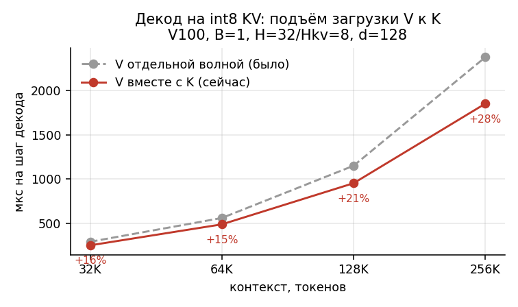
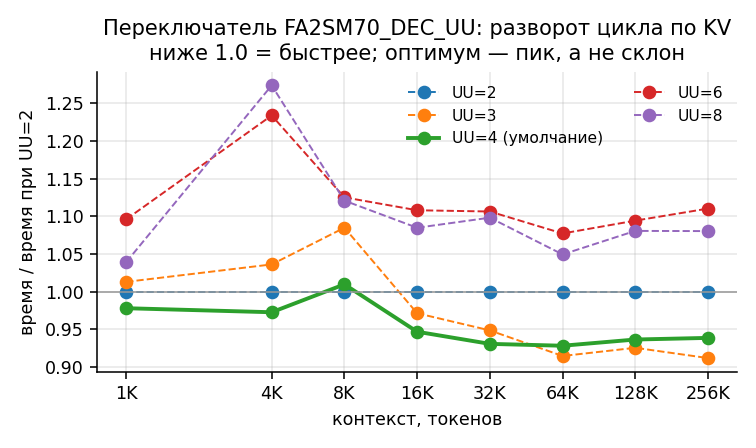
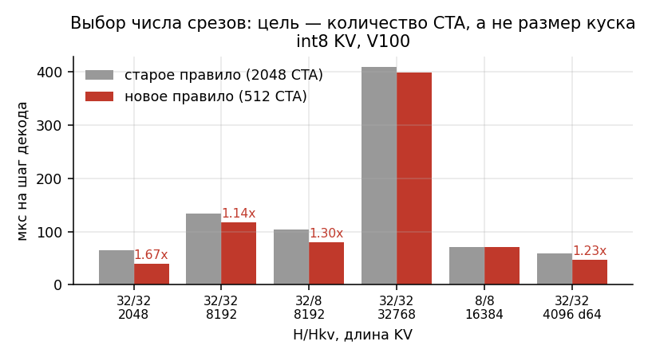
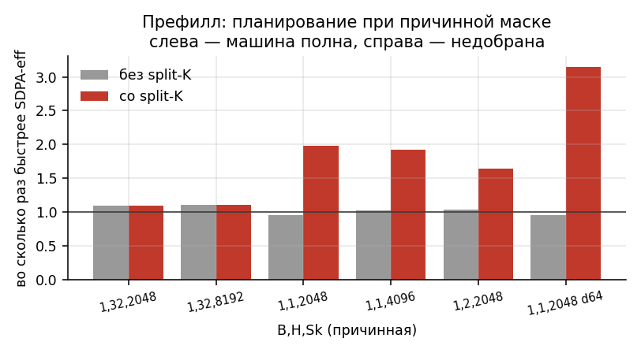
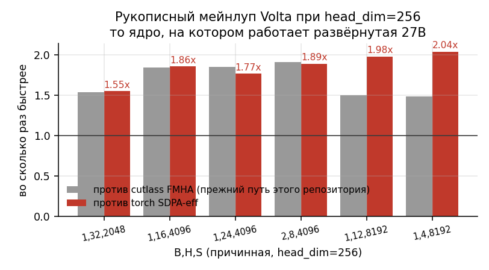
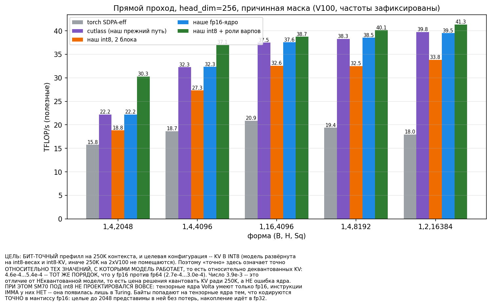
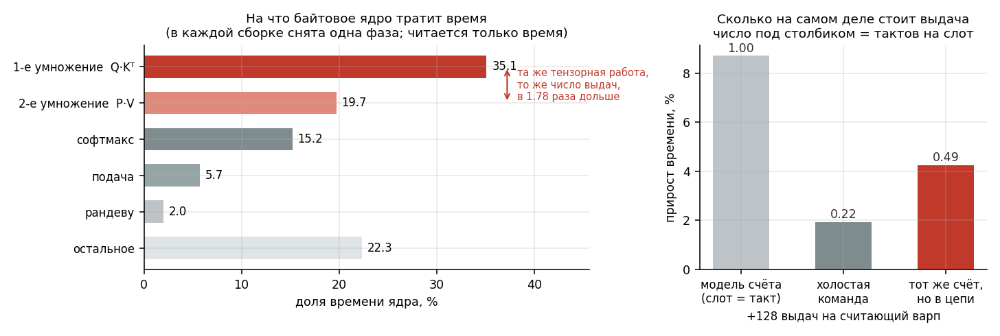

# ХУЛИГАН — класс ядер для инференс-движка на NVIDIA Volta (`sm_70`)

> *«Абсурдность локального хода — это ПОИСКОВЫЙ признак.»*

[English](README.md) | **Русский**


Импортируемый пакет PyTorch, несущий **целый вычислительный слой инференс-движка** на железе,
которое экосистема списала: внимание во всех трёх режимах (префилл, декод, обучение), линейный скан
gated-delta, пути квантованных весов (GPTQ-int8, MXFP4) и обслуживание страничного KV-пула.
Современная FlashAttention (`sm_80+`) и FlashInfer (`sm_75+`) здесь не запускаются вообще, а штатный
путь PyTorch/vLLM отказывает на половине современных форматов — поэтому часть строк ниже это не
«быстрее», а разница между «работает» и «не работает».

Каждое ядро точное и сверено с fp32-оракулом точного софтмакса; неочевидные алгоритмы выведены ниже
с доказательствами и рецептами независимой проверки.

**Метод уезжает дальше самих ядер.** В `docs/` записан не журнал сделанного, а способ: как замером
назвать ресурс, который ядро на данной машине действительно связывает, и дальше хулиганить именно по
нему — учёт по слотам выдачи и граница, за которой он перестаёт предсказывать
([`VOLTA_SM70.md`](docs/VOLTA_SM70.md) §3b), разложение фальсификаторами, лестница «сперва
бесплатное», каталог расхождений инструментария с железом. Ничего из этого не привязано к Volta.

**Начинать отсюда:** [`docs/KERNELS.ru.md`](docs/KERNELS.ru.md) — что за ядра, с чем едят, как запускают.

<details>
<summary><b>Почему «ХУЛИГАН»</b></summary>

Потому что каждый ход, который здесь сработал, по отдельности выглядит как нарушение приличий — и
именно поэтому его никто не сделал раньше. Абсурдность локального хода оказалась не
противопоказанием, а **поисковым признаком**: там, где нормальный инженер говорит «так не делают»,
обычно и лежит незанятый ресурс.

- У `sm_70` **нет инструкции int8** на тензорных ядрах. Приличный ответ — «int8 на Volta невозможен».
  Хулиганский — закодировать байт **в мантиссу fp16** (`0x6400 | u` это ровно `1024 + u`) и свернуть
  постоянное смещение в ранг-1 поправку. Результат: байтовое ядро **быстрее fp16-ядра** на железе,
  которое про int8 не знает.
- Хвостовая плитка ключей читала за конец тензора. Приличный ответ — предикатная загрузка. Замерено:
  **−7.7% скорости**. Хулиганский — **зажать адрес на заведомо неверную, но валидную строку**: её
  вклад ровно ноль, поэтому годится любое конечное число. Одна целочисленная команда, ноль потерь.
- Двенадцать варпов в блоке делают **разную работу**: четыре только везут, восемь только считают.
  Приличный ответ — «варпы должны быть симметричны». Замерено: **1.22–1.46×** к симметричному варианту.
- Прямая проверка **опровергла нашу же доктрину**: мы записали «ядро за стеной выдач, каждая команда
  стоит такт», а холостая команда показала **0.22 такта**. Хулиганство работает только вместе со
  вторым правилом — **беспощадно мерить**; иначе это просто наглость.

Метод в одну строку: **назови замером ресурс, который действительно связывает, и хулигань именно по
нему.** Всё остальное в `docs/` — инструменты для первой половины этой фразы.

</details>

## Что здесь есть, кроме скорости: форматы, которых на V100 не было вообще

Часть строк ниже — это не «быстрее», а разница между «работает» и «не работает». Средний столбец —
то, что делает штатная связка vLLM/PyTorch на этом железе.

| возможность | штатный путь на V100 | здесь |
|---|---|---|
| **MXFP4-веса** (gpt-oss) | **отказ**: `mxfp4 is not supported ... Minimum capability: 80` | **работает** — свой бит-точный распаковщик плюс слитый GEMV, потребляющий веса упакованными |
| **8-битный KV-кэш** (`fp8_e4m3`) | **отказ** Triton-бэкенда: `type fp8e4nv not supported in this architecture` | **работает**, и именно там отрыв по декоду наибольший |
| **int8 / int4 KV** | нет | декод: `quantize_kv`, int8 ≈ 0.7% ошибки. Префилл: байтовое ядро при `d=256`, которое **быстрее fp16-ядра**, хотя инструкции int8 на тензорных ядрах у `sm_70` нет — а его отгруженный формат склада (смещённый байт + чередующиеся масштабы) обгоняет и маршрут `e5m2` при точности в 7.8 раза лучше |
| **bf16 на входе** | эффективный бэкенд SDPA отвергает | принимается (приводится к fp16) |
| **head_dim > 256** | flash требует sm_80+, SDPA ограничен | до **1024** на префилле, 512 на декоде/бэкварде |
| **head_dim не кратный 8** | эффективный бэкенд SDPA отвергает | дополняется нулями, работает |
| **скользящее окно** | слитого пути нет → маска `[S,S]` и путь MATH | слитое, `O(Sk·W)`, **24×** к запасному |
| **двустороннее окно** | нет | слитое, **27×** |
| **soft-cap логитов** (Gemma) | **невыразимо** — нелинейность, аддитивной маски не существует | слитый |
| **ALiBi** | материализованная маска | слитый, **13×** |
| **обучение** (`dQ/dK/dV`) | — | точный backward, head_dim ≤ 512, воспроизводимый dropout |
| **paged KV + varlen** | — | block table, `cu_seqlens` |
| **GQA/MQA** | расширение K/V | нативно, без расширения |

**20/20** наборов тестов проходят на V100 (`tests/run_all.py`), каждое ядро сверено с fp32-оракулом.

---

## Скорость: откуда она берётся

- **Prefill** (точный, тензорные ядра `sm_70`): быстрее `scaled_dot_product_attention` на **каждой**
  измеренной форме. При `head_dim ≤ 128` внутренний цикл — cutlass'овский, а выигрыш даёт
  **планирование** причинной работы по 80 SM (§5): **1.07–1.10×**, когда голов хватает, чтобы занять
  машину, и **1.64–3.15×**, когда не хватает. При `head_dim = 256` внутренний цикл **наш**:
  рукописный мейнлуп Volta (§6) полностью заменяет cutlass и даёт **1.55–2.04×** к SDPA-eff при
  40–47% достижимой крыши. А когда KV-кэш **байтовый** — конфигурация, к которой контекст 250K на
  2×V100 принуждает, — ядро с разделением варпов по ролям при `d=256` доходит до **1.94–2.35×** к
  SDPA-eff, обгоняя даже наше собственное fp16-ядро в 1.02–1.34 раза на железе, у которого
  **инструкции int8 на тензорных ядрах нет вообще** (раздел «Измерено»).
- **Decode** (split-KV, ядро, которого на V100 не было): **3.0–11.3×** к SDPA-eff на fp16 и
  **4.1–15.9×** на int8, бит-точно (`relL2 ≤ 1e-6`).
- **Training**: точный backward, изолированно **1.02–1.06×** при d=512, **1.12–1.69×** при d=256 и
  **1.16–1.31×** при d=128 (последняя строка — с прошлого прохода, эта пара форм в перемер не входила).

### Декод по контексту (рабочий диапазон 32K–256K, int8 KV)



Загрузка `V` шла отдельной, более поздней волной, хотя ни от чего вычисленного не зависит. Подъём её
к `K` удваивает число обращений в полёте на варп: **+16% на 32K и +28% на 256K**, причём выигрыш
растёт с длиной. Арифметика не сдвинута — результат бит-в-бит прежний.

### Переключаемые параметры ядра



Оптимум — **пик, а не склон**: разворот стоит `UU×EPT` регистров, поэтому и `UU=1`, и `UU=6` хуже
середины. И он **зависит от формы** — `UU=4`, настроенный на `d=128`, стоил реальной модели с
`d=256` десяти процентов, — поэтому умолчание выводится из `EPT`, а ручки остались:
`FA2SM70_DEC_UU`, `FA2SM70_DEC_VK`, `FA2SM70_DEC_GF`, `FA2SM70_DEC_PF`.

### Сколько срезов брать: цель — число CTA, а не размер куска



Пять форм из шести хотят 16 срезов, шестая — 64, и **у всех шести** произведение `B·H·срезы` равно
512, то есть около 6.4 CTA на SM. Прежнее правило целилось в 2048 CTA и дробило вчетверо лишку.

### Префилл: планирование при причинной маске



Когда голов много, машина и так полна, и остаётся только **порядок** блоков. Когда мало — расписание
упирается в **самое длинное задание**, и дробление этого задания по ключам даёт кратный выигрыш.
Столбик ниже единицы — та форма (`d=64`), которая **проигрывала** торчу до этой работы.

---

## Быстрый старт

```python
import torch, fa2_sm70

# prefill (точный), Q [B,H,Sq,D] fp16, K/V [B,Hkv,Sk,D] fp16 (GQA/MQA годятся)
O, lse = fa2_sm70.attention(Q, K, V, causal=True)

# обучение: дифференцируемое точное внимание (autograd dQ/dK/dV), head_dim <= 512
O = fa2_sm70.flash_attn_func(Q, K, V, causal=True); O.sum().backward()

# шаг декода (Sq==1), точный fp16
O, lse = fa2_sm70.decode(q, K, V)                      # q [B,H,1,D]

# префилл при head_dim=256 на БАЙТОВОМ KV (контексты 250K; формат 8, см. docs/KERNELS.ru.md)
cache  = fa2_sm70.quantize_kv_prefill(K, V)              # K/V [B,Hkv,Sk,256] -> байтовый склад + масштабы
O, lse = fa2_sm70.prefill_bytes(Q, cache, causal=True)   # Q/O [B,Sq,H,256] fp16 (BSHD)

# декод из int8- (или int4-) KV-кэша: квантовать один раз, декодировать много
cache = fa2_sm70.quantize_kv(K, V, bits=8)
O, lse = fa2_sm70.decode_quantized(q, cache)

# MXFP4 (OCP Microscaling) -- на Volta этого нет больше нигде
W = fa2_sm70.mxfp4_dequant(blocks, scales)             # блоки uint8 [..., nblk, 16], масштабы E8M0
```

Сборка, установка и полный список API — в [README.md](README.md). Математика ниже дана
развёрнуто; таблицы измерений совпадают в обеих версиях.

---

## Почему именно эти алгоритмы — математика

### 1. Точное внимание через онлайн-софтмакс
Софтмакс инвариантен к сдвигу: `softmax(s) = softmax(s − c)` при любом `c`. Отсюда рекуррентность,
которая позволяет обработать ключи блоками и НИКОГДА не материализовать матрицу `S = QKᵀ` целиком.
Для блока `j` с максимумом `mⱼ` и суммой `ℓⱼ`:

    m ← max(m, mⱼ),   ℓ ← e^{m_old−m}·ℓ + e^{mⱼ−m}·ℓⱼ,   O ← e^{m_old−m}·O + e^{mⱼ−m}·ℓⱼ·Ôⱼ

Память падает с `O(S²)` до `O(S·d)`, а результат **точный**, а не приближённый: расхождение с fp32-
эталоном (2.6e-04) — это округление fp16, ровно такое же, как у эталонного ядра.

### 2. Расщепление по ключам при декоде (`Sq = 1`)
При `Sq = 1` работы на голову ровно `Sk·d` умножений, и один блок на голову оставляет 80 SM почти
пустыми. Ключевой диапазон режется на `s` срезов, каждый даёт пару `(Oc, LSEc)`, и они сшиваются той
же тождественностью, что и выше. Важное следствие, которое легко упустить: **цель — количество CTA,
а не размер куска**. Прежнее правило целилось в 2048 CTA (25 волн на 80 SM) и переусердствовало
вчетверо, стоив до 1.67×; пять форм из шести хотят 16 срезов, шестая 64, и все шесть попадают в
`B·H·splits = 512`.

### 3. Отложенное перемасштабирование
В наивной записи каждый блок ключей умножает накопитель `O` на `e^{m_old−m}` — это последовательная
зависимость длиной во весь цикл. Но множители телескопируются: можно копить `O` без
перемасштабирования и применить `e^{m_final−m}` ОДИН раз в эпилоге, если хранить логарифм суммы.
Цикл становится цепочкой независимых FMA, и планировщик получает свободу переупорядочивания.

### 4. int8/int4 KV — единственный путь за потолок пропускной способности
Декод при длинном контексте упирается в ЧТЕНИЕ кэша, а не в счёт: при 256K токенах и `H=32, d=128`
это гигабайты на шаг. Квантование потокенное с масштабом на строку, `k = s·q + z`; скалярное
произведение раскладывается как `q·k = s·(q·q̂) + z·Σq̂`, где второе слагаемое одинаково для всех
ключей строки и выносится из цикла. Ошибка внимания 7e-03 при int8 — она поглощается софтмаксом,
потому что тот чувствителен к РАЗНОСТЯМ логитов, а не к их абсолютной величине.

### 5. Планирование причинной маски по 80 SM
При причинной маске плитки запросов **резко неравны**: плитка `i` просматривает
`⌈((i+1)·kQ + off)/kK⌉` плиток ключей, то есть при `kQ=32, kK=128, S=2048` веса идут `1 … 16`.
Отсюда два независимых факта.

**(а) Порядок.** Диспетчер раздаёт блоки по возрастанию `blockIdx`, поэтому в огрызок последней
волны попадают САМЫЕ ТЯЖЁЛЫЕ плитки — максимум работы на почти пустой машине. Разворот
(`q0 = gridDim.x−1−blockIdx.x`) это классическая жадная эвристика «сначала самое длинное» и стоит
одного вычитания. Замерено: **+19.6% при `S=4096`, +29.8% при `S=8192`** на изолированном ядре.

**(б) Дробление.** Расписание не может быть короче своей САМОЙ ДЛИННОЙ задачи. При `S=2048, B·H=1`:
`Σw = 544`, слотов 240 → идеал 2.27, тогда как `max w = 16` — **семикратный перекос, который не
лечится никаким порядком**. Резать надо КЛЮЧИ, а не запросы: вдвое меньший `kQ` удваивает число
блоков, но последняя плитка всё равно просматривает все ключи, поэтому `max w` не меняется, а идеал
падает — перекос становится ХУЖЕ.

**Когда НЕ дробить.** Сшивка стоит `(s+1)·B·H·Sq·d·4` байт независимо от тяжести плиток, поэтому
окупается только на тяжёлых. Две формы с одинаковым числом блоков и почти одинаковым перекосом
разошлись в разные стороны (`1,1,8192,128` **+37%**, `1,4,2048,128` **−4%**), и различает их
СРЕДНЯЯ тяжесть плитки (32.5 против 8.5 плиток ключей).

### 6. Рукописный мейнлуп Volta и законы плитки (`head_dim = 256`)
Всё выше опирается на cutlass. При `head_dim = 256` этого перестаёт хватать, причём не из-за
недоработки: `mma_tensor_op_sm70.h:136` требует `Shape % GemmShape<32,32,4>`, потому что раскладки
операндов Volta в cutlass ОРГАНИЗОВАНЫ плитками 32×32, а `pitch_linear_thread_map.h:298` отвергает
256-широкую плитку ключей. Обе стены — метапрограммные, а не аппаратные: плитка 32×16 это просто две
операции `m8n8k4` на парах квадов.

**Инструкция, как она измерена.** `mma.sync.aligned.m8n8k4` выдаётся **на пару квадов**, а не на
варп: пара `p` владеет полосами `{4p..4p+3} ∪ {4p+16..4p+19}`, и четыре пары варпа исполняют четыре
НЕЗАВИСИМЫХ произведения 8×8×4. Подача «полоса `l` даёт строку `l` матрицы A и столбец `l` матрицы B»
считает четыре ДИАГОНАЛЬНЫХ блока 8×8 из 32×32 — 256 ячеек из 1024. Первая версия заголовка делала
именно это и **проходила сверку значений с torch**, потому что сверка значений сравнивает те ячейки,
которые карта называет, а это ровно те ячейки, которые частичный обход и посчитал. Поэтому
корректность утверждается ПОКРЫТИЕМ: каждая ячейка выхода штампуется атомарным счётчиком.

**Закон 1 — число варпов ограничено плиткой запросов.** У операнда A (плитка `Q`) в raked-раскладке
ровно одна непрерывная векторная итерация, поэтому все варпы обязаны уложиться вдоль strided:
`варпов ≤ kQ/8`. При `варпов = (kQ/32)·(kK/WarpN)` это в точности **`WarpN ≥ kK/4`**. Захардкоженная
`WarpShape<32,32>` выполняет условие до `kK = 128` и даёт `1/2 = 0` при 256 — то есть ошибка cutlass
это целочисленное деление, дошедшее до нуля, а не неподдерживаемая форма.

**Закон 2 — регистровый налог конвейера равен `(BK·D/8)/нитей` на нить.** Прогон плитки ключей через
регистры стоит одного вектора на нить на ступень, поэтому налог ОБРАТНО пропорционален числу нитей:
замерено 124 → 168 регистров при 4 варпах (+44) и 124 → 234 при 2 варпах (+110) на той же плитке.

**Частичное (дозированное) заполнение плитки — рычаг, вытекающий из закона 2.** Конвейер не обязан
быть «всё или ничего». Из `kStage` векторов, нужных плитке, через регистры ведутся только `PS` (их
`LDG` выдаётся заранее), остальные грузятся и кладутся на месте. Освободившиеся регистры уходят на
удержание фрагментов `Q` на весь блок запросов — единственную предзагрузку, которая измеренно
платит (+16%) и которая упиралась ровно в этот бюджет: обрыв приходился на 28–32 группы `k`. Тот же
приём применим к самой плитке: 64-широкую загрузку можно заполнить **тремя** 16-широкими под-плитками,
отбросив четвёртую, когда та добавляет только давление на регистры. И то и другое — «заполнить плитку
неполно, намеренно», и выбирается это ЗАМЕРОМ, а не соображениями симметрии.

**Закон 3 — загрузки-на-MMA нельзя оптимизировать в отрыве от регистров.** `ncu` назвал ось верно
(конвейер L1 на 61.6% против 38% тензорного), но очевидный ход — самая плотная подача — **проиграл**:

| плитка варпа | загр/MMA | регистров | разлив | `S=8192, H=4` |
|---|--:|--:|--:|--:|
| 32×32 | 1.00 | 254 | 16 Б | 4.752 мс |
| **32×16** | **1.50** | **178** | **0** | **3.663 мс** |
| 16×16 | 2.00 | 182 | 0 | 4.400 мс |
| 16×32 | 1.50 | 204 | 0 | 5.964 мс |

Это трёхсторонний компромисс Volta (`docs/VOLTA_SM70.md`): занятость, трафик и загрузки-на-MMA нельзя
максимизировать втроём, и профилировщик, назвавший ось, не называет НАПРАВЛЕНИЕ по ней.

Отдельно — [`docs/COMPILER_VS_HARDWARE.md`](docs/COMPILER_VS_HARDWARE.md): каталог замеренных
случаев, где nvcc / ptxas / cutlass делают не то, что следует из модели железа (потолок регистров из
`__launch_bounds__` и молчаливый разлив под него; кадр стека при НУЛЕ разливов; постоянная память,
сериализующаяся на расходящихся полосах; `--use_fast_math`, обнуляющий законные субнормальные;
стены cutlass, оказывающиеся целочисленным делением до нуля). У каждого пункта — рецепт обнаружения.

Подробный разбор — в рабочих тетрадях этого порта, они на русском:
[`docs/KERNELS.ru.md`](docs/KERNELS.ru.md) (каталог: что за ядра, с чем едят, как запускают),
[`docs/SM70_KERNEL_PLAYBOOK.md`](docs/SM70_KERNEL_PLAYBOOK.md) (как строить ядро руками: раскладка
инструкции и все четыре её варианта, чего не понимает компилятор, закон геометрии плитки, дисциплина
замера, и §51 — как оценить цену единицы счёта ДО того, как по ней оптимизировать) и
[`docs/SM70_LATENCY_HIDING.md`](docs/SM70_LATENCY_HIDING.md) (каталог механизмов сокрытия
задержки: что есть в железе, чего нет, и что строится программно).

Отгружено: `BQ=64, BK=64`, 8 варпов (2×4), плитка варпа 32×16, `K` кусками по `DC=64` программным DMA,
развёрнутый порядок блоков — 178 регистров, разлив 0, 84 КБ разделяемой памяти. Окрестность, замерено:
`DC=32` → 3.760 мс, `DC=128` → 3.723, широкая 128-битная загрузка → 3.944, дополнение вместо
перемешивания → 4.828, без разворота порядка → 3.988. Откат: `FA2SM70_NO_VOLTA_FWD=1`.


---

## Измерено (V100-SXM2-32GB, драйвер 580.159.03, `torch 2.7.0+cu126`, fp16)

**Перемерено 31.07.2026 с частотами, зафиксированными на 1530 МГц**, на свободной карте: число чужих
процессов печатается до и после каждого прогона. Точечные замеры, не гарантии.

### Prefill, причинная маска

| B, H, Sk, d | наши | без split-K | SDPA | SDPA-eff | % крыши | наши/eff |
|---|--:|--:|--:|--:|--:|--:|
| *машина полна — split-K не включается* |||||||
| 1, 32, 1024, 128 | 0.280 мс | 0.281 | 0.300 | 0.300 | 32.7% | **1.07×** |
| 1, 32, 2048, 128 | 0.947 мс | 0.944 | 1.034 | 1.031 | 38.8% | **1.09×** |
| 1, 32, 4096, 128 | 3.530 мс | 3.522 | 3.841 | 3.833 | 41.6% | **1.09×** |
| 1, 16, 2048, 64 | 0.359 мс | 0.359 | 0.398 | 0.394 | 25.6% | **1.10×** |
| 1, 32, 8192, 128 | 13.697 мс | 13.614 | 15.036 | 15.071 | 42.9% | **1.10×** |
| *машина недобрана — включается split-K (`d ≤ 128`)* |||||||
| 1, 1, 2048, 128 | **0.061 мс** | 0.127 | 0.121 | 0.121 | 18.9% | **2.00×** |
| 1, 1, 4096, 128 | **0.140 мс** | 0.262 | 0.271 | 0.269 | 32.8% | **1.92×** |
| 1, 2, 2048, 128 | **0.092 мс** | 0.146 | 0.151 | 0.151 | 24.9% | **1.64×** |
| 1, 1, 2048, 64 | **0.047 мс** | 0.156 | 0.148 | 0.148 | 12.2% | **3.15×** |
| 1, 2, 4096, 64 | **0.164 мс** | 0.340 | 0.374 | 0.374 | 28.0% | **2.28×** |

**«% крыши» считается от ИЗМЕРЕННЫХ 93.6 TFLOP/s, а не от 125.3 из спецификации.** 125.3
предполагает бустовую частоту и безупречную выдачу HMMA; плотный fp16-GEMM на этой карте упирается
в 93.6 (`docs/VOLTA_SM70.md`, `[spec]` против `[measured]`). Считать от спецификации — занизить
каждую строку в 1.34 раза и выдать ядро, идущее на 60% возможного, за 45%.


> **Исправление (в этом проходе).** Столбец «% крыши» до сих пор показывал половину истинного
> значения: `bench_prefill.py` считал `2·B·H·S²·d` флопов, тогда как forward внимания — это **два**
> матмуля, `4·B·H·S²·d`. Времена ядра всегда были верны, занижена была только доля крыши. Исправлено
> и перемеряно — это важно, потому что по этому столбцу и судят, сколько запаса осталось.

Точность во всех строках `relL2 ≈ 2.6e-04` — split-K её не меняет, потому что частичные результаты
копятся во fp32.

### Prefill при `head_dim = 256` (рукописный мейнлуп)

Геометрия гибридных сеток (Qwen3.5: 24 головы на 4 KV, `d=256`, полное внимание каждый 4-й слой).
`cutlass` здесь — ПРЕЖНИЙ путь этого же репозитория (расщепление V + 64-плитка запросов).

| B, H, S | наши | cutlass | SDPA-eff | к cutlass | к SDPA-eff | % крыши |
|---|--:|--:|--:|--:|--:|--:|
| 1, 32, 2048 | **1.815 мс** | 2.798 | 2.813 | 1.54× | **1.55×** | 40.5% |
| 1, 16, 4096 | **3.357 мс** | 6.194 | 6.230 | 1.85× | **1.86×** | 43.8% |
| 1, 24, 4096 | **4.944 мс** | 9.156 | 8.730 | 1.85× | **1.77×** | 44.6% |
| 2, 8, 4096  | **3.346 мс** | 6.384 | 6.315 | 1.91× | **1.89×** | 43.9% |
| 1, 12, 8192 | **9.329 мс** | 14.024 | 18.435 | 1.50× | **1.98×** | 47.2% |
| 1, 4, 8192  | **3.244 мс** | 4.830 | 6.612 | 1.49× | **2.04×** | 45.3% |



Чанковый префилл (`Sq < Sk`, маска по правому нижнему углу): 12/2 `8192×65536` **141.99 мс** против
212.59 (1.50×), 24/4 `8192×65536` **278.95** против 419.20 (1.50×), 43.6–45.3 TFLOP/s.

**torch намеренно отсутствует во второй таблице.** `is_causal=True` выравнивает маску по ЛЕВОМУ
ВЕРХНЕМУ углу, поэтому при `Sq < Sk` он считает только первые `Sq` ключей: его время перестаёт расти
с контекстом, и он показывает 602 TFLOP/s при пике 93.6. Он измеряет не то же самое, и приводить его
было бы не лестно, а недостоверно.


### Prefill при `head_dim = 256` с **int8-KV**: разделение варпов по ролям

Задача, ради которой этот путь и строился, — **префилл на контексте 250K** у модели, развёрнутой на
int8-весах и int8-KV: во fp16 кэш на 250K на 2×V100 не помещается вовсе. То есть байтовый формат
здесь **требование**, а не оптимизация, и вопрос стоит только один — насколько быстро Volta можно
заставить на нём считать.

Точка входа (`bench_fwd_roles.py`, `tests/test_volta_fwd.py`) — отдельное ядро со своей сигнатурой,
потому что принимает квантованные тензоры вместе с масштабами:

```python
ext = fa2_sm70._ext.prefill_ext()
O, lse = ext.attn_fwd_volta_i8(Q, Kq, Kscale, Vq, Vscale, scale, causal)  # Kq/Vq int8, масштабы fp16
```

Через `fa2_sm70.attention` оно **недоступно** (та принимает K/V в fp16). А вот в обвязку vLLM оно
подключено — по `FA2SM70_SHIM_I8=1`, по умолчанию выключено; что это дало и почему выключено, записано
ниже отдельным разделом. `FA2SM70_WS=0` выбирает прежнее двухблочное int8-ядро для сверки.



| форма B,H,Sq,Sk | SDPA-eff | cutlass | int8, 2 блока | **наш fp16** | **наш int8 + роли** | к fp16 | к SDPA-eff |
|---|---:|---:|---:|---:|---:|---:|---:|
| 1,4,2048,2048 | 0.570 | 0.366 | 0.438 | **0.368** | **0.275** | 1.34× | 2.07× |
| 1,4,4096,4096 | 1.820 | 1.017 | 1.203 | **0.988** | **0.874** | 1.13× | 2.08× |
| 1,16,4096,4096 | 6.506 | 3.452 | 3.925 | **3.505** | **3.347** | 1.05× | 1.94× |
| 1,4,8192,8192 | 6.924 | 3.371 | 3.961 | **3.483** | **3.252** | 1.07× | 2.13× |
| 1,2,16384,16384 | 14.930 | 6.421 | 7.445 | **6.482** | **6.343** | 1.02× | 2.35× |

Время в мс, причинная маска, частоты зафиксированы, одна обвязка на все пути, усечённое среднее.
`cutlass` — снова прежний путь этого же репозитория, `наш fp16` — тот самый мейнлуп из таблицы выше,
так что последняя колонка меряется от той же базы, что и весь раздел.

**Как устроено.** Один блок, 12 варпов: **четыре везут** (перекладывают плитку K/V целиком в теневой
буфер), **восемь считают** (оба умножения и софтмакс). Связь — именованными барьерами, **одна встреча
на плитку**, буфер двойной. Один блок не подпадает под порог 48 КБ на блок, под который попали бы два
соседа по SM, поэтому доступны все 96 КБ разделяемой памяти — занято 88.5.

Именно роли, а не два блока, потому что между блоками **нет связи**: межблочного барьера у Volta нет,
и сдвиг фаз между блоками не удерживается — проверено начальным зазором, точной шахматкой по `%smid`,
поворотом порядка обхода TPC и сдвигом банковой базы; все четыре замера отрицательны. Внутри блока
связь есть и стоит **2.76 такта** на сигнал.

**Инструкции int8 на тензорных ядрах у Volta нет вообще.** Они умеют только fp16; `IMMA` появилась в
Turing. Байты попадают на них тем, что кодируются **точно** в мантиссу fp16 — `0x6400 | u` это ровно
`1024 + u`, — целые до 2048 представимы без потерь, накопление идёт в fp32. Постоянное смещение `1024`
снимается не поэлементно, а **свёрткой в ранг-1** (`Σa(C+b) = Σab + C·Σa`), одним числом на строку;
сам разворот стоит **три инструкции на четыре байта** вместо двадцати, потому что это перестановка
байт, а не арифметика. Поэтому ядро ничего не приближает — оно считает ту же сумму, что посчитало бы
fp16-ядро на деквантованных значениях, и таблица точности ниже именно это и показывает.

Итого на железе, сделанном под fp16 и больше ни подо что, формат, которого у этого железа никогда не
было, **обгоняет fp16** в 1.03–1.36 раза в зависимости от формы.

#### Точность: три разных числа, и путать их нельзя

| что с чем | ошибка | что это значит |
|---|---|---|
| наш int8 против **деквантованного** fp64 | **4.6e-4…5.4e-4** | **целевая метрика**: точность на тех значениях, с которыми работает модель |
| наш fp16 против fp64 | 2.7e-4…3.0e-4 | округление формата — **тот же порядок** |
| наш int8 против **неквантованного** fp64 | 3.9e-3…4.1e-3 | цена решения квантовать KV ради 250K, **не ошибка ядра** |

Первая строка целевая, и она того же порядка, что вторая: на своих входных значениях байтовое ядро
так же верно, как fp16-ядро на своих. Третья измеряет **решение о квантовании**, а не ядро — цену,
заплаченную сознательно, чтобы 250K вообще поместились. Какая из трёх строк относится к вам, зависит
от того, откуда берётся кэш: если он уже в int8 (случай инференса), то верна первая, и других нет.

Проверено: 16 тестов `pytest` (`tests/test_volta_fwd.py`, оба пути — fp16 и байтовый) плюс 15 форм
через точку входа — GQA до 6:1, батч до 4, рваные `Sq`, чанковые вплоть до 1:64, без причинной маски.
Ошибка 3.2e-4…9.1e-4 при пороге 3e-3.

#### Байтовый KV: три маршрута — и который отгружать (`e5m2` уже не он)

Положить один байт на элемент KV на машине без инструкции int8 можно тремя способами, и различаются
они тем, **кто платит за разворот**.

**`e5m2` — формат, разворот которого ядру не стоит ничего.** У `fp8_e5m2` смещение порядка (15) и
порядок полей те же, что у fp16, поэтому байт e5m2 **и есть** старший байт fp16:
`fp16_bits == byte << 8`, побитово, включая поддённормальные и Inf/NaN. Разворот — одна перестановка
байт, и он **точен**; свёртка смещения в ранг-1, нужная int8-пути, исчезает совсем, как и масштаб на
позицию — формат несёт свой порядок сам. Точка входа `attn_fwd_volta_e5m2(Q, Kb, Vb, scale, causal)`:
K/V однобайтовые, аргументов-масштабов нет вовсе. На **одних и тех же значениях** он возвращает
побитово тот же выход, что fp16-ядро (`torch.equal`, все шесть причинных форм набора).

**Но у `e5m2` три бита мантиссы**, и это свойство **формата**, а не ядра — вопрос, на который
побитовое равенство не отвечает. На одних и тех же данных:

| байтовый маршрут | relL2 к fp32-оракулу | почему |
|---|--:|---|
| int8 + масштаб на позицию | **7.0e-3** | 8 бит мантиссы, масштаб на строку ключа |
| `e5m2` | 5.4e-2 | 3 бита мантиссы, зато порядок у каждого элемента |

**Отсюда задача: сохранить точность int8 и забрать скорость e5m2.** Разрыв между ними был не в
арифметике, а в том, что int8-путь обязан притащить таблицу масштабов, — а перепись SASS говорит, что
таблица стоит +14 `LDG`, но **+36 `IMAD` и +11 `IADD3`**: платится не объём (0.8% трафика), а
**пересчёт 64-битного адреса на каждое обращение**. Лечится двумя ходами, оба — в квантователе, а не
в мейнлупе, и оба не трогают значения:

1. **Смещённый байт** (`u = v + 128`, пишется при укладке) — XOR знака уходит из ядра. Смещение
   разворота 1152 одинаково в обоих случаях, вопрос был только в том, кто его платит.
2. **Чередующаяся таблица** — `(k_scale, v_scale)` рядом по позиции, чтобы одна загрузка `.64`
   приносила обе величины с ОДНОГО адреса, а указатель на плитку считался один раз.

Это и есть **формат 8**: `fa2_sm70.quantize_kv_prefill(K, V)` + `fa2_sm70.prefill_bytes(Q, cache, ...)`.
Медианы парных отношений к отгруженному int8-пути, 17 раундов, `d=256`, `H=16/Hkv=2`, `Sq=512`,
причинная маска, частоты зафиксированы, карта свободна:

| Sk | отгруж. int8 | `e5m2` | смещ. байт + таблица | **формат 8** | ф8 / int8 | ф8 / e5m2 |
|---|--:|--:|--:|--:|--:|--:|
| 8 192 | 1.829 мс | 1.765 | 1.764 | **1.721** | **1.061×** | 1.020× |
| 32 768 | 7.262 мс | 6.895 | 6.960 | **6.842** | **1.064×** | 1.009× |
| 131 072 | 29.259 мс | 27.791 | 28.000 | **27.569** | **1.061×** | 1.006× |

`torch.equal(формат 8, отгруженный int8) == True` на каждой форме — это перераспределение работы, а не
другая арифметика, — поэтому формат 8 сохраняет строку 7.0e-3 из таблицы точности выше и при этом идёт
вровень с e5m2 или чуть быстрее. Последний столбец читать сдержанно: вторая обвязка
(`bench_i8_beats_e5m2.py`, другие формы) даёт ф8/e5m2 = 1.012× при `Sk=4096`, спадая до 0.999× при
131 072. **Честная формулировка — паритет-до-1.02× к e5m2 при точности в 7.8 раза лучше**, а не разгром.

> **Предупреждение, которое стоит дороже этих 6%.** Ранжирование форматов **по числу команд** даёт
> ответ **наоборот**: у формата 7 слотов МЕНЬШЕ ВСЕХ (2814, потолок 72.8%), у формата 8 БОЛЬШЕ ВСЕХ
> (3142, потолок 65.2%) — а быстрее формат 8. Выдача на этом ядре стоит **0.22 такта, когда её
> результата никто не ждёт, и 0.49, когда она стоит в цепи подачи операнда** — те же +128 команд,
> разница в 2.2 раза, — то есть счёт это не время. Полный вывод и фальсификаторы —
> `docs/VOLTA_SM70.md` §3b, где стоит и **закрытая проверка**: сутки этот вывод был помечен спорным
> (отдельный стенд намерил подачу операнда вдвое дешевле), но спорным оказался стенд, а не документ.
> Цена MIO мерится **вайвфронтами**, `max(конфликтность, ширина·на·полосу/8 Б, 1)`, и связывает
> **конфликтность банков**: при неизменных 128 уникальных байтах один только шаг раскладки меняет
> цену в **32 раза**. Проверено счётчиком `ncu` — 0 расхождений из 17. Расчёт 768 ≈ 795 не просто
> устоял, он был **консервативным**: счётчик даёт трафика на 11 % больше расчётного.



#### И `e4m3` — тот формат, которым живёт KV-пул движка

У `e4m3` смещение порядка 7, поэтому нужен пересчёт, и трудность вся в перекладке бит: знак едет на
8 позиций, остальные семь — на 7, между полями разрыв, которого перестановка байт не делает. Ровно
поэтому репозиторий держал **приватный** int8-формат пула — законный лишь пока все читатели наши, и
это была настоящая мина (на Gemma-4 сорок слоёв из сорока восьми прочли бы наш int8 как `e4m3`).

В прежнем приговоре оказались неверны две вещи, и обе нашлись замером, а не перечитыванием:

1. **Разворот стоит 6 инструкций на четыре байта, а не записанные «минимум 8».** Приём — **режим
   размножения знака у `prmt`** (старший бит нибла селектора размножает знак байта): кладём пару
   `[b, sign(b)]` в соседние байты, сдвигаем влево на 7 — данные попадают в разряды 13..7, знак в
   15-й, — и остаётся одна маска. `__byte_perm` этого режима не даёт, нужен PTX. Пересмещение ×256
   сворачивается ранг-1 в `qk_scale` и в эпилог и **точно** (степень двойки).
2. **Прежняя цена снята на зависимой цепи, а §3b говорит, что это неверная линза.** В цепи выходило
   1.698 к базе без разворота; **в ядре это 1.162 к e5m2** — изолированный микробенч завысил на 46%.

| маршрут | к `e5m2` | к отгруженному int8 | relL2 к fp32 |
|---|--:|--:|--:|
| `e5m2` | 1.000 | 1.058 | 5.44e-2 |
| **`e4m3`, прямой (`nosc=11`)** | **0.862** | **1.10×** | **2.68e-2** |
| int8 + масштаб на позицию (формат 8) | 1.001–1.026 | 1.06× | 7.0e-3 |

То есть `e4m3` идёт **в 1.10 раза быстрее отгруженного int8-пути** и по точности встаёт между двумя
байтовыми форматами — вдвое лучше `e5m2` и в 3.8 раза хуже int8 с масштабом. Умолчанием остаётся int8
там, где все читатели наши; `e4m3` — маршрут для чужого пула. Побитово сверен с неподвижным
эталоном `e5m2` на данных, которые оба формата держат точно (`tests/test_fwd_e4m3.py`), а сам
разворот точен на всех 254 конечных значениях байта.

**Формат дёшев на тензорных ядрах Volta, когда его раскладка — префикс fp16; а когда не префикс —
цена это константа, а не стена.**

#### До какого `head_dim` дотягивает схема ролей

Ограничитель — **двойной буфер целой плитки K/V**, `2·BK·((d+16) + (dv+16))` элементов: он линеен по
`d` и удваивается буферизацией. Вторым связывает накопитель `O`, `BQ·dv/(32·считающих)` регистров на
нить. Обе величины арифметические, поэтому предел считается, а не ищется перебором сборок —
`tools/volta_ws_dlimit.py`, сверенный с отгруженной конфигурацией (32/64/256, 8 считающих варпов →
90 624 Б, те самые замеренные 88.5 КБ):

| `d` | int8-KV | fp16-KV |
|---|---|---|
| 256 | 32/64/256, 2×4, 88 КБ, **1 проход** | 32/32/256, 2×2, 86 КБ, **1 проход** |
| 384 | 32/32/384, 2×2, 76 КБ, **1 проход** | 64/16/192, 4×1, 89 КБ, 2 прохода |
| 512 | 32/32/256, 2×2, 84 КБ, 2 прохода | — не влезает |
| 640 | 32/32/160, 2×2, 94 КБ, 4 прохода | — не влезает |
| 768 | — не влезает | — не влезает |

(`BQ`/`BK`/`dv`, сетка варпов `WM×WN`, разделяемая память и во сколько проходов по `S` обходится
разрезание выхода; считающих не меньше четырёх, потому что меньшим числом четверых везущих не
покрыть.) **int8 доходит до `d=640`, fp16 — до `d=384`**: отношение 1.67, а не 2, потому что удваивается
только буфер K/V — `Q` и `P` у обоих путей в fp16.

Важнее предела **граница одного прохода**. `dv < d` означает, что выход режется на `d/dv` срезов и `S`
пересчитывается на каждый — ровно та работа, ради устранения которой схема и строилась. Один проход
держится до `d=384` на int8 и до `d=256` на fp16, а отгруженная точка `d=256`/int8 — последняя, где
один проход достаётся при **восьми** считающих варпах. Отсюда и ×1.36 именно там; и отсюда же, что на
`d=512` повторения ждать не следует: два прохода — это примерно в 1.5 раза больше работы.

И отдельно: fp16 отваливается на `d=512` не по одной лишь ёмкости. При `BK=16` буфер влезает, но тогда
`WN=1`, и плитка варпа `BQ/WM` при четырёх считающих оказывается меньше шага фрагмента `mma.sync` в 16
элементов; а `BQ=64` вместо этого раздувает подачу `Q`. Связывает **сочетание** ёмкости и кратности
шестнадцати, поэтому «добавить памяти» здесь не помогло бы.

#### Наши ядра в vLLM: теперь ПЕРВОКЛАССНЫЙ БЭКЕНД, а не подмена модуля

Прежняя врезка подменяла чужой пакет `flash_attn_v100` по `PYTHONPATH`. Это работает и замерено ниже,
но у подмены есть цена: держа чужие сигнатуры, мы не можем честно объявить, что поддерживаем, — и это
дало настоящий дефект: склад KV и внимание оказались за РАЗНЫМИ условиями, поэтому приватный int8-пул
мог прочитаться чужим читателем как `e4m3` (на Gemma-4 это сорок слоёв из сорока восьми, читающих
мусор).

Замена — **свой бэкенд `FA2_SM70`** в актуальном форке vLLM: свой член перечисления, свой файл, свои
объявленные возможности и **отказ на подъёме** вместо падения в середине прохода. Проверено
поведением, а не осмотром:

| | |
|---|---|
| модели | Llama-3.2-1B и **Gemma-4-12B** — вывод **посимвольно совпадает** с чужим бэкендом |
| формы | `head_dim` 64/128/**256/512**, скользящее окно 1024, чанковый префилл, GQA/MQA |
| KV-пул | fp16, **`fp8_e4m3`**, `int8_per_token_head`; формат отмечается **НА КЭШЕ**, читатель сверяет отметку |
| контекст | **×2.00** на байтовом пуле (11 261 → 22 523 токена для Gemma-4 на одной V100-32GB) |
| префилл | **1.88×** при L=1024 и **3.12×** при L=4096 к Triton-бэкенду форка (воспроизводится с точностью 0.2% на трёх проходах) |
| декод | паритет на fp16, до **1.42×** на байтовом пуле |

У префилльного отрыва есть механизм, а не загадка: **Triton на `sm_70` не эмитит HMMA** и считает
внимание на конвейере FMA. А байтовый пул `e4m3` на Volta обслуживаем вообще только мы — Triton
отказывается прямо: `type fp8e4nv not supported in this architecture`.

По дороге нашлись два дефекта **в нашем собственном коде**, оба тихие: диспетчер декода кончался
веткой по умолчанию и при неподдержанном `head_size` возвращал НЕВЕРНЫЙ РЕЗУЛЬТАТ вместо отказа; и
питоновская обвязка стоила **вдесятеро** дороже ядер, которым служит (13–16 мс против 1.3–4.0 мс на
шаг), потому что пересчитывала на каждом слое то, что общее на KV-группу.

#### Байтовый маршрут префилла в vLLM — и отрицательный результат, который он принёс

Ядро ролей подключено к обвязке vLLM (`FA2SM70_SHIM_I8=1`, **по умолчанию выключено**): байтовый
сборщик (`gather_paged_kv_i8`, сверен ПОБИТОВО с явным эталоном на четырёх геометриях) превращает
страничный пул в int8 с масштабом на позицию, и префилл уходит в `attn_fwd_volta_i8` вместо
fp16-мейнлупа. Замер (GPU0/1, PCIe, частоты зафиксированы, веса AWQ, уникальные промпты, ток/с):

| промпт, токенов | fp16-путь | байтовый маршрут | incumbent | наше / incumbent |
|---:|---:|---:|---:|---:|
| 4 119 | 1 396 | 1 394 | 1 309 | 1.07 |
| 16 367 | 1 267 | 1 269 | 1 150 | 1.10 |
| 32 775 | 1 228 | 1 231 | 695 | 1.77 |
| 65 448 | 1 124 | 1 132 | 412 | 2.75 |

**Сквозняком байтовый маршрут не меняет ничего** — разница внутри шума 0.7%. И это не провал ядра:
время внимания В СЕРВЕРЕ упало 11.68 → 11.21 с, ровно те 4%, что ядро даёт изолированно. Это
результат про **долю**: на изолированном прогоне 4×65K внимание, которое обслуживает это ядро, заняло
**36.35 с из 222.47 с стены префилла — 16.3%**. Даже бесконечно быстрое внимание дало бы здесь 1.195×,
а ядро на 1.02–1.05× даёт 0.6% — что и вышло. (Цифра 1.36× выше — с недозагруженной машины, `B·H = 4`;
при TP=2 эта модель кладёт на карту 12 голов, и машина полна.) **Долю надо мерить ДО встраивания**:
она стоила одного прогона профиля, встраивание — дня.

И маршрут стоит точности, потому что пул хранит `fp8_e4m3`, а ядро ест int8, то есть квантование идёт
**дважды** (relMax к деквантованному пулу):

| Sq / T / H / Hkv | fp16-путь | байтовый маршрут | хуже |
|---|---:|---:|---:|
| 512 / 2048 / 12 / 2 | 5.87e-4 | 7.41e-3 | 12.6× |
| 1024 / 4096 / 8 / 2 | 4.66e-4 | 8.32e-3 | 17.9× |
| 256 / 1024 / 4 / 4 | 4.49e-4 | 7.53e-3 | 16.8× |

Причина **в форматах, а не в ядре**: e4m3 держит *относительную* точность на всём размахе, а int8 с
масштабом по строке — *абсолютную*, поэтому мелкие значения строки с большим максимумом теряют почти
все разряды. Перекантовка выбрасывает ровно то свойство, ради которого e4m3 и выбирают. Отсюда и
умолчание «выключено»; сам маршрут оставлен, потому что делает исправление дешёвым и конкретным.

**Как убрать потерю полностью — и это одно место в ядре.** Скорость ядра ролей берётся не из «int8 на
тензорных ядрах»: инструкции int8 у `sm_70` нет, счёт в любом случае идёт в fp16. Она берётся из
**перевозки байтов и разворота в регистрах**. Значит формат байта можно менять, а **каждое значение
e4m3 точно представимо в fp16** (знак тот же, порядок смещается на +8, мантисса сдвигается влево на 7,
поддённормальные e4m3 попадают в нормальные fp16). Разворот e4m3 вместо int8 поэтому **точен побитово**,
не трогает ни формат пула, ни хранение, ни декод, превращает сборку в простое копирование байтов и
**убирает свёртку смещения в ранг-1** (снимать `+1024` больше не нужно). Замерить, а не предположить,
надо ровно одно: влезет ли более длинный разворот (3–4 операции на значение против 0.75 у байтовой
перестановки) в свободные слоты выдачи — одна fp32 и одна int32 на HMMA. Примитив уже есть,
`e4m3_to_float_fast`. Если же формат пула менять можно, второй путь — хранить сразу int8 с масштабом на
позицию: одно квантование вместо двух, точность 4.6e-4 (*лучше* нынешнего e4m3), но он трогает
хранение, декод и таблицу масштабов, тогда как разворот e4m3 — одну функцию.

### Decode, `Sq=1` (микросекунды; ускорение к `SDPBackend.EFFICIENT_ATTENTION`)

| H/Hkv, Sk, d | SDPA-eff | fp16 | int8 | fp16× | int8× | relL2 fp16 / int8 |
|---|--:|--:|--:|--:|--:|--|
| 32/32, 2048, 128 | 151 | 51 | 37 | **3.0×** | **4.1×** | 3e-7 / 7e-3 |
| 32/32, 8192, 128 | 585 | 171 | 114 | 3.4× | 5.1× | 5e-7 / 7e-3 |
| 32/8, 8192, 128 | 583 | 64 | 75 | **9.1×** | 7.8× | 5e-7 / 7e-3 |
| 32/32, 32768, 128 | 2304 | 635 | 398 | 3.6× | 5.8× | 9e-7 / 7e-3 |
| 8/8, 16384, 128 | 1141 | 101 | 72 | **11.3×** | **15.9×** | 6e-7 / 7e-3 |
| 32/32, 4096, 64 | 380 | 50 | 46 | 7.6× | 8.2× | 4e-7 / 6e-3 |

### Режимы, которых у SDPA нет слитыми (`B=2,H=16,S=4096,d=128`, причинная)

| режим | конфигурация | наши | лучший путь SDPA | ускорение |
|---|---|--:|--:|--:|
| скользящее окно | `W=1024` | **1.95 мс** | 47.93 мс (маска+MATH) | **24.5×** |
| двустороннее окно | `W=512, R=256` | **1.79 мс** | 47.98 мс (маска+MATH) | **26.8×** |
| ALiBi | 16 голов | **3.68 мс** | 48.20 мс (маска+MATH) | **13.1×** |
| soft-cap логитов | `cap=50` | **4.50 мс** | *маршрута нет — нелинейность* | — |

### Обучение: forward против forward+backward

| B, H, S, d | fwd | fwd+bwd | bwd/fwd | SDPA-eff fwd+bwd | наши/SDPA |
|---|--:|--:|--:|--:|--:|
| 2, 16, 2048, 128 | 0.94 мс | 4.21 мс | 4.5× | 5.11 мс | **1.21×** |
| 1, 32, 4096, 128 | 3.48 мс | 14.10 мс | 4.1× | 18.21 мс | **1.29×** |
| 4, 8, 2048, 64 | 0.59 мс | 2.96 мс | 5.0× | 3.13 мс | **1.06×** |
| 1, 8, 8192, 128 | 3.45 мс | 14.36 мс | 4.2× | 17.87 мс | **1.25×** |
| 1, 8, 2048, 256 | 0.81 мс | 3.02 мс | 3.7× | 4.30 мс | **1.42×** |
| 1, 1, 2048, 256 | 0.21 мс | 0.83 мс | 4.0× | 1.24 мс | **1.49×** |
| 1, 32, 2048, 256 | 2.74 мс | 11.02 мс | 4.0× | 15.13 мс | **1.37×** |
| 2, 8, 1024, 256 | 0.42 мс | 1.86 мс | 4.4× | 2.40 мс | **1.29×** |
| 1, 8, 2048, 512 | 1.60 мс | 7.92 мс | 5.0× | 8.33 мс | **1.05×** |

### Изолированный backward при больших head_dim

| B, H, S, d | наши | SDPA-eff | наши/SDPA | relL2 |
|---|--:|--:|--:|--:|
| 1, 1, 2048, 256 | 0.579 мс | 0.979 мс | **1.69×** | 4.3e-04 |
| 1, 8, 512, 256 | 0.370 мс | 0.415 мс | **1.12×** | 4.5e-04 |
| 2, 8, 1024, 256 | 1.450 мс | 1.841 мс | **1.27×** | 4.5e-04 |
| 1, 8, 2048, 256 | 2.259 мс | 3.193 мс | **1.41×** | 4.5e-04 |
| 1, 32, 2048, 256 | 8.330 мс | 11.882 мс | **1.43×** | 4.5e-04 |
| 1, 8, 1024, 512 | 1.957 мс | 2.079 мс | **1.06×** | 6.1e-05 |
| 1, 8, 2048, 512 | 6.300 мс | 6.421 мс | **1.02×** | 6.3e-05 |

---

## Как это проверить самому

```bash
python tests/run_all.py            # 20 наборов тестов -> "20/20"
python tests/test_smoke_cpu.py     # проверка API без GPU

python benchmarks/bench_prefill.py     # префилл против SDPA; колонку без split-K меряет сам,
                                       # запуская себя дочерним процессом -- A/B одной командой
python benchmarks/bench_decode.py      # декод fp16/int8/int4
python benchmarks/bench_train.py       # fwd против fwd+bwd
python benchmarks/bench_bwd_large.py   # изолированный backward, d=256/512, с проверкой relL2
python benchmarks/bench_modes.py       # окно / двустороннее окно / ALiBi / softcap
```

Оракул независимый: тесты сверяются с `softmax(scale·Q·Kᵀ)·V`, посчитанным во fp32 обычным
PyTorch — общего кода с ядрами нет, поэтому ошибка в ядре не может спрятаться.

**Дисциплина измерения.** Частоты V100 плавают под нагрузкой, поэтому закрепляйте их
(`nvidia-smi -lgc`) — один прогон с картой на 135 МГц вместо 1380 сделал целую таблицу непригодной.
И первый замер каждого размера после загрузки занижает результат до двух раз (захват CUDA-графа,
JIT, рост аллокатора): `bench_server.py` теперь прогревает каждый размер отдельно.

## Лицензия и происхождение

Код пакета (`fa2_sm70/`, `tests/`, `benchmarks/`) © 2026 xormal (Alexander Romanoff), **MIT**
(`LICENSE`). Вложенные исходники NVIDIA **CUTLASS** + FMHA в `fa2_src/` — **BSD-3-Clause**
(`fa2_src/cutlass/LICENSE.txt`, коммит в `fa2_src/CUTLASS_COMMIT.txt`).
